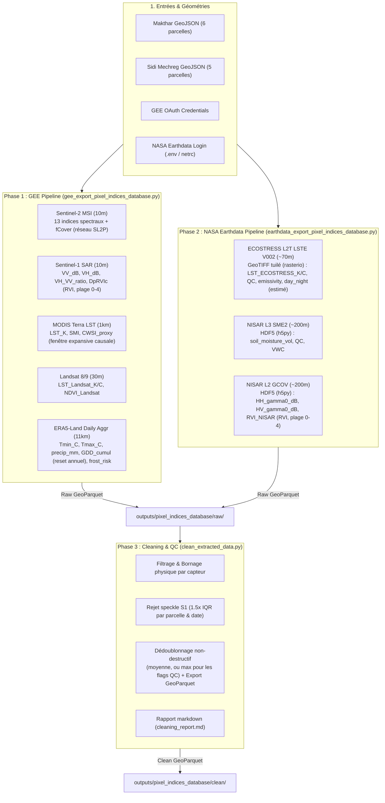
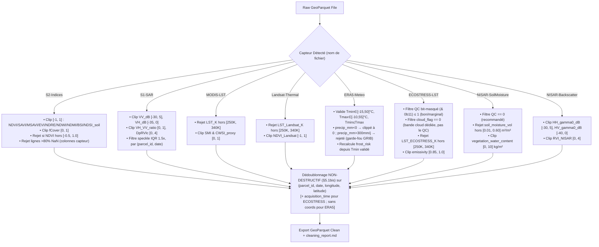

# 🛰️ Documentation Technique : Pipeline Spatiale Multi-Satellitaire — AWAM

**Projet :** AWAM  
**Sites d'étude :** Makthar (6 parcelles) & Sidi Mechreg (5 parcelles)  
**Chemin du module :** `scripts/EXTRACT/`  
**Scripts couverts :** `gee_export_pixel_indices_database.py`, `earthdata_export_pixel_indices_database.py`, `clean_extracted_data.py`, `run_all_extractions.py`, `export_latest_rasters.py`, `test_extract_pipeline.py`  
**Stage dans le Pipeline Master :** Stage 1  
**Dernière mise à jour :** 26 Août 2026


## 📑 Table des Matières
1. [Vue d'Ensemble & Architecture Globale](#1-vue-densemble--architecture-globale)
2. [Entrées & Parcelles Spatiales (Inputs)](#2-entrées--parcelles-spatiales-inputs)
3. [Phase 1 : Extraction Google Earth Engine](#3-phase-1--extraction-google-earth-engine-gee_export_pixel_indices_databasepy)
4. [Phase 2 : Extraction Directe NASA Earthdata](#4-phase-2--extraction-directe-nasa-earthdata-earthdata_export_pixel_indices_databasepy)
5. [Phase 3 : Nettoyage & Validation Qualité](#5-phase-3--nettoyage--validation-qualité-clean_extracted_datapy)
6. [Orchestrateur Principal](#6-orchestrateur-principal-run_all_extractionspy)
7. [Dictionnaire des Données & Schémas Complétés](#7-dictionnaire-des-données--schémas-complétés)
8. [Organisation des Répertoires & Sorties (Outputs)](#8-organisation-des-répertoires--sorties-outputs)
9. [Guide de Démarrage & Commandes CLI](#9-guide-de-démarrage--commandes-cli)
10. [Historique des Corrections & Limites Connues](#10-historique-des-corrections--limites-connues)

---

## 1. Vue d'Ensemble & Architecture Globale

La pipeline de données spatiales du projet AWAM extrait, calcule et valide automatiquement des séries temporelles d'indices spectraux, de températures de surface, de rétrodiffusion radar SAR, d'humidité du sol et de données météorologiques, à la **résolution pixel** (et au niveau parcelle en repli pour les capteurs à faible résolution).

Le système intègre **8 produits satellitaires & réanalyses environnementales**, réparties en **2 pipelines d'extraction indépendants** (GEE côté serveur, Earthdata en traitement local) puis **1 pipeline de nettoyage**, le tout piloté par un orchestrateur unique :



**Points clés d'architecture (v2) :**
- Les deux pipelines d'extraction (GEE, Earthdata) sont des **scripts Python autonomes**, chacun exécutable seul ou via l'orchestrateur.
- Le pipeline Earthdata télécharge les granules **un par un, extrait, puis supprime immédiatement le fichier local** (`fpath.unlink()`) pour ne jamais accumuler plusieurs Go sur disque — indispensable pour NISAR GCOV, dont un seul granule peut peser plusieurs Go (voir §4.3).
- Une option **expérimentale de streaming HTTPS** (`--stream`) permet, pour NISAR, de lire uniquement la petite fenêtre de pixels utile autour des parcelles **sans jamais télécharger le fichier entier** (voir §4.4).
- Chaque extracteur applique une **stratégie à deux niveaux** : masque polygonal pixel-par-pixel, puis **repli sur le centroïde** si le polygone de la parcelle est trop petit pour la résolution du capteur (garantit 0 donnée manquante même pour ERA5-Land à 11 km).
- La Phase 3 ne se contente pas de filtrer : elle **fusionne intelligemment** les observations en conflit plutôt que de les jeter (voir §5.1bis) — une nuance importante pour qui interprète le taux de rétention des données.

---

## 2. Entrées & Parcelles Spatiales (Inputs)

### 2.1 Parcelles Agricoles

Le pipeline s'appuie sur deux fichiers GeoJSON WGS84 (`EPSG:4326`) :

1. **Makthar (Gouvernorat de Siliana)** — `parcelles_fermes_makthar_wgs84_wwc.geojson`
   - 6 parcelles : `makthar_P1` à `makthar_P6`
   - Cultures : Amandier, Olivier, Sol nu
   - Superficie totale : ~7.11 ha (confirmé sur les données livrées : 0.965 + 1.420 + 0.735 + 1.436 + 1.628 + 0.924 = 7.108 ha)

2. **Sidi Mechreg (Gouvernorat de Bizerte)** — `parcelles_fermes_sidi_mechreg_wgs84_wwc.geojson`
   - 5 parcelles : `Kemel_1`, `Kemel_2`, `Kemel_3`, `Yahia_4`, `Badreddine_5`
   - Cultures : Lavande/Romarin/Géranium(/Sauge), Caroubier, Olivier/Citronnelle/Verveine
   - Superficie totale : ~4.36 ha

Les deux fichiers sont chargés, reprojetés en EPSG:4326 si nécessaire, puis fusionnés avec un `parcel_id` unique par site (`load_parcels()`, dupliqué à l'identique dans les scripts GEE et Earthdata pour garantir un référentiel de parcelles cohérent entre les deux pipelines). Le `parcel_id` de Makthar est construit comme `makthar_{name}` (ex. `makthar_P1`) ; celui de Sidi Mechreg comme `sidi_mechreg_{name_sans_espaces}_{id}`.

### 2.2 Métadonnées de culture : `culture_declaree_parcelle` & `signal_partage`

Chaque parcelle passe par `parse_culture_metadata()`, qui :
- Renvoie tel quel les libellés spéciaux (`Aucune`, `Sol nu`, `Other`, `N/D`) avec `signal_partage = False`.
- Sinon, découpe la chaîne de culture sur `/`, `+` et `,` (ex. `"Lavande/Romarin/Geranium"` → 3 espèces), filtre les mentions d'adventices (`weed`, `advantis`), et pose **`signal_partage = True` dès que plus d'une espèce valide est déclarée sur la même parcelle**.

➡️ `signal_partage` sert de signal d'alerte en aval (nettoyage, analyse) : un pixel sur une parcelle en polyculture mélange le signal spectral/radar de plusieurs espèces, ce qui doit être pris en compte avant d'interpréter un indice comme spécifique à une seule culture.

### 2.3 Période Temporelle d'Extraction
- **Sentinel-2 / Sentinel-1 / MODIS / Landsat / ERA5-Land / ECOSTRESS** : `2025-05-01` → date du jour (`datetime.now()`).
- **NISAR (SME2 & GCOV)** : `2026-06-17` (mise en service opérationnelle du capteur) → date du jour.

---

## 3. Phase 1 : Extraction Google Earth Engine (`gee_export_pixel_indices_database.py`)

Ce module s'authentifie auprès de l'API Python de Google Earth Engine (projet GEE `awam-504508` par défaut, configurable via la variable d'environnement `GEE_PROJECT`) et extrait pixel par pixel les données Sentinel, MODIS, Landsat et ERA5-Land.

### 3.1 Produits Satellitaires & Variables Calculées

| Capteur / Produit | Collection GEE | Résolution d'échantillonnage | Variables extraites |
| :--- | :--- | :--- | :--- |
| **Sentinel-2 MSI** | `COPERNICUS/S2_SR_HARMONIZED` | 10 m | `NDVI`, `SAVI`, `MSAVI`, `EVI`, `NDRE`, `CI_RedEdge`, `VARI`, `NDWI`, `NDMI`, `BSI`, `Carbonate_SWIR`, `NDSI_soil`, `SI_soil`, `fCover` |
| **Sentinel-1 SAR** | `COPERNICUS/S1_GRD` | 10 m | `VV_dB`, `VH_dB`, `VH_VV_ratio`, `DpRVIc` |
| **MODIS Terra Thermal** | `MODIS/061/MOD11A1` | 1 km (buffer centroïde 1500 m) | `LST_K`, `SMI`, `CWSI_proxy` |
| **Landsat 8/9 Thermal** | `LANDSAT/LC08/C02/T1_L2` + `LANDSAT/LC09/C02/T1_L2` | 30 m | `LST_Landsat_K`, `LST_Landsat_C`, `NDVI_Landsat` |
| **ERA5-Land Daily Aggr.** | `ECMWF/ERA5_LAND/DAILY_AGGR` | 11 km (buffer centroïde 55 000 m) | `Tmin_C`, `Tmax_C`, `precip_mm`, `GDD_cumul`, `frost_risk` |

**Filtres appliqués à la sélection des scènes (avant tout calcul d'indice) :**
- **Sentinel-2** : `CLOUDY_PIXEL_PERCENTAGE < 60` (filtre au niveau scène ; le masquage fin par pixel se fait ensuite via `SCL`, voir §3.2).
- **Sentinel-1** : `instrumentMode == "IW"` et polarisations `VV` **et** `VH` présentes simultanément (rejette les acquisitions VV-seul ou HH/HV).
- **Landsat 8/9** : `CLOUD_COVER < 60` (même seuil que S2), collections L8 et L9 fusionnées et triées par date.

> ⚠️ **Correction par rapport aux versions antérieures de cette documentation** : le produit MODIS utilisé est **uniquement Terra (`MOD11A1`)**, pas Aqua (`MYD11A1`) — le code n'interroge jamais cette seconde collection. De même, la variable `LST_K` est unique (bande `LST_Day_1km` uniquement) ; il n'existe pas de `LST_Night_K` dans la sortie actuelle. Enfin, la collection météo utilisée est **`ECMWF/ERA5_LAND/DAILY_AGGR`** (agrégats journaliers), pas la collection horaire — la pluie (`precip_mm`) **est bien extraite** malgré ce qu'indiquaient certains scripts d'analyse antérieurs qui s'appuyaient sur un export CSV plus ancien n'incluant pas la pluie.

### 3.2 Formules Exactes des Indices

**Sentinel-2** (`add_s2_indices`, bandes en réflectance `[0,1]` après `mask_clouds_s2` qui exclut via `SCL` tout sauf végétation/sol nu/eau/non-classé/neige) :

| Indice | Formule |
| :--- | :--- |
| NDVI | `(B8 − B4) / (B8 + B4)` |
| SAVI | `(B8 − B4) / (B8 + B4 + L) × (1 + L)`, avec `L = 0.428` |
| MSAVI | `(2·B8 + 1 − √((2·B8+1)² − 8·(B8−B4))) / 2` |
| EVI | `2.5 × (B8 − B4) / (B8 + 6·B4 − 7.5·B2 + 1)` |
| NDRE | `(B8 − B5) / (B8 + B5)` |
| CI_RedEdge | `B7 / B5 − 1` |
| VARI | `(B3 − B4) / (B3 + B4 − B2)` |
| NDWI | `(B3 − B8) / (B3 + B8)` |
| NDMI | `(B8 − B11) / (B8 + B11)` |
| BSI | `((B11+B4) − (B8+B2)) / ((B11+B4) + (B8+B2))` |
| Carbonate_SWIR | `B11 / B12` |
| NDSI_soil | `(B4 − B11) / (B4 + B11)` |
| SI_soil | `√(B4 × B11)` |
| fCover | Réseau de neurones SL2P (SNAP v2.1, Weiss & Baret 2016), 11 entrées (8 bandes réfléchies + cos(angle zénithal de visée), cos(angle zénithal solaire), cos(azimut relatif)) → 5 neurones cachés (tanh) → 1 sortie, avec normalisation/dénormalisation, contrôle de domaine de validité des réflectances/angles en entrée et de la sortie (voir `compute_fcover_ee` et coefficients `SL2P_FCOVER_COEFFS`). Les angles de visée/soleil sont lus dans les métadonnées de la scène S2 (`MEAN_SOLAR_ZENITH_ANGLE`, `MEAN_SOLAR_AZIMUTH_ANGLE`, `MEAN_INCIDENCE_ZENITH/AZIMUTH_ANGLE_*` moyennés sur les 8 bandes SL2P). |

**Sentinel-1** (`add_s1_indices`, filtre médian focal 3×3 appliqué à VV/VH avant export) :
- `VV_lin = 10^(VV/10)`, `VH_lin = 10^(VH/10)`
- `VH_VV_ratio = VH_lin / VV_lin`
- `q = VH_lin / (VV_lin + VH_lin)` ; **`DpRVIc = 4·q`** (Radar Vegetation Index dual-pol standard pour données d'intensité, Trudel et al. 2012 ; Nasirzadehdizaji et al. 2019 ; même formule que le script custom "Radar Vegetation Index for Dual Polarimetric" de Sentinel Hub).
  > ⚠️ **Correction** : la formule `4·q·(1−q)` utilisée dans une version antérieure du code (et de cette documentation) n'est **pas** le RVI dual-pol publié. Le vrai DpRVI polarimétrique (Mandal et al. 2020, *Remote Sensing of Environment* 247:111954) est un indice différent, construit à partir du degré de polarisation et des valeurs propres de la matrice de covariance 2×2, qui **nécessite des données SLC** — les données GRD (amplitude) utilisées ici ne permettent pas de le calculer. La colonne est conservée sous le nom `DpRVIc` pour compatibilité descendante avec les fichiers existants, mais contient désormais `RVI = 4·q`, dont la **plage théorique est `[0, 4]`** (et non `[0, 1]`) — confirmé empiriquement sur les données fournies (`DpRVIc` max observé ≈ 3.70).

**MODIS** (`process_lst`) :
- `LST_K = LST_Day_1km × 0.02` (facteur d'échelle standard MOD11A1)
- `SMI` et `CWSI_proxy` sont des indices **relatifs**, recalculés **par parcelle**, sur une **fenêtre expansive (cumulative) et causale** de la série temporelle — c'est-à-dire que la valeur d'une ligne donnée ne dépend que des observations **jusqu'à et y compris sa propre date**, jamais des observations futures :
  - `SMI = (LST_max_expansif − LST) / (LST_max_expansif − LST_min_expansif)`, où `LST_max_expansif`/`LST_min_expansif` sont le max/min glissant-expansif de `LST_K` pour la parcelle, calculés à partir d'au moins 2 observations (`NaN` sinon). Ce n'est **pas** un indice d'humidité du sol physique (type TVDI classique nécessite un triangle sec/humide spatial), mais une normalisation min-max temporelle par parcelle.
  - `CWSI_proxy = clip((LST − LST_p05_expansif) / (LST_p95_expansif − LST_p05_expansif), 0, 1)`, où `LST_p05_expansif`/`LST_p95_expansif` sont les 5ᵉ/95ᵉ centiles **expansifs** (calculés sur l'historique disponible jusqu'à cette date) de la série de la parcelle, calculés seulement une fois que la parcelle a accumulé plus de 5 observations valides (`NaN` avant ce seuil).
  > ⚠️ **Correction** : une version antérieure calculait ces deux indices sur **toute la série temporelle disponible** (y compris les dates futures par rapport à chaque ligne), ce qui les rendait non-causaux et **instables** : la valeur de `SMI`/`CWSI_proxy` déjà écrite pour mai 2025 changeait silencieusement à chaque nouvelle exécution du script incluant des dates plus récentes, parce que le min/max/centiles de référence se déplaçaient. Avec la fenêtre expansive, une valeur déjà écrite pour une date donnée ne change plus jamais lors d'exécutions ultérieures.

**Landsat 8/9** (`add_landsat_thermal`, masque nuages via bits QA_PIXEL : bit 1 = nuage dilaté, bit 3 = nuage, bit 4 = ombre de nuage — les trois doivent être à 0 pour qu'un pixel soit conservé) :
- `LST_Landsat_K = ST_B10 × 0.00341802 + 149.0` ; `LST_Landsat_C = LST_Landsat_K − 273.15`
- `NDVI_Landsat = (SR_B5·0.0000275 − 0.2 − (SR_B4·0.0000275 − 0.2)) / (somme des mêmes termes)`

**ERA5-Land** (`process_agera5`) :
- `Tmin_C = temperature_2m_min − 273.15` ; `Tmax_C = temperature_2m_max − 273.15`
- `precip_mm = total_precipitation_sum × 1000`
- `GDD_cumul` : cumul de `max(0, (Tmax+Tmin)/2 − 10)` (base 10 °C), **par parcelle ET par année civile** — le compteur est remis à zéro chaque 1er janvier (clé interne `(parcel_id, année)`). Confirmé sur les données fournies : `GDD_cumul` atteint 2 694.99 le 31/12/2025 pour `makthar_P1`, puis retombe à `0.00` le 01/01/2026.
  > ⚠️ **Correction** : une version antérieure indexait l'accumulation uniquement par `parcel_id`, donc `GDD_cumul` s'accumulait en continu sur toute la fenêtre d'extraction (mai 2025 → aujourd'hui, 16+ mois), sans remise à zéro saisonnière — peu pertinent agronomiquement, un GDD étant normalement réinitialisé chaque saison de culture/année civile. Ajuster la base de 10 °C par culture si des dates de plantation réelles sont disponibles.
- `frost_risk = 1 si Tmin < 0 °C sinon 0`

### 3.3 Algorithme d'Extraction Spatiale
1. **Masque polygonal** : `sampleRegions`/`reduceRegions` extrait tous les pixels dont le centre tombe dans le polygone de la parcelle, à l'échelle native du capteur.
2. **Repli centroïde via buffer** : pour les capteurs à faible résolution par rapport aux parcelles (MODIS : buffer 1500 m ; ERA5-Land : buffer 55 000 m autour du centroïde), le masque est remplacé par un **buffer centré sur le centroïde**, garantissant toujours au moins une valeur par parcelle et par date. C'est cette stratégie qui explique pourquoi le fichier ERA5-Meteo contient exactement `n_dates × n_parcelles` lignes (aucun trou) alors que les capteurs optiques haute résolution en ont naturellement (passages nuageux).
3. **Traitement par lots** (`BATCH_SIZE_IMAGES = 5`) pour Sentinel-2, Sentinel-1 et Landsat, avec retries automatiques (`MAX_RETRIES = 3`, délai `RETRY_DELAY = 10 s`, délai croissant `10s, 20s, 30s`) sur les erreurs de calcul GEE transitoires (timeouts, quotas). MODIS et ERA5-Land sont traités image par image (sans lot) car les requêtes `reduceRegions` associées sont moins coûteuses.

### 3.4 Sorties
Un fichier GeoParquet par site et par type de donnée, nommé via `build_output_filename()` :
`AWAM_GEE_{site}_ALL_{datatype}_{start}_{end}_v{version}.parquet`
(ex. `AWAM_GEE_makthar_ALL_S2-Indices_20250501_20260811_v2.parquet`)

Avant écriture, `save_geoparquet()` supprime les lignes **entièrement vides** sur les colonnes capteur (100 % NaN parmi les colonnes non-métadonnées) — ces trous surviennent typiquement lors des passages nuageux Sentinel-2.

---

## 4. Phase 2 : Extraction Directe NASA Earthdata (`earthdata_export_pixel_indices_database.py`)

Ce module s'authentifie via `earthaccess` (stratégies essayées dans l'ordre : variables d'environnement `EARTHDATA_USERNAME`/`EARTHDATA_PASSWORD`, `~/.netrc`, puis interactif), lit un fichier `.env` optionnel (`load_env_file`), et traite en local des formats raster **GeoTIFF (ECOSTRESS)** et **HDF5 (NISAR)**.

> ⚠️ **Point technique important** : les deux produits n'ont **pas** le même format ni la même bibliothèque de lecture. ECOSTRESS L2T est un **GeoTIFF tuilé**, lu avec `rasterio`. NISAR (SME2 et GCOV) est du **HDF5**, lu avec `h5py`. Une confusion entre les deux formats a été la cause de plusieurs bugs corrigés en cours de projet (voir §10).

### 4.0 Correctif d'environnement PROJ/GDAL

En tout début de script, les variables d'environnement `PROJ_LIB`/`PROJ_DATA` sont **supprimées** si présentes :
```python
for _env in ["PROJ_LIB", "PROJ_DATA"]:
    if _env in os.environ:
        del os.environ[_env]
```
Cause du problème : le `proj.db` embarqué par `pyproj` (VERSION_MINOR=4) est trop ancien pour le GDAL utilisé par `rasterio`. Si `PROJ_DATA` pointe vers ce fichier cassé, `rasterio.open()` réussit mais **toute reprojection CRS échoue silencieusement**, produisant des valeurs `NaN` sur 100 % des pixels ECOSTRESS sans lever d'erreur explicite. Supprimer ces variables force GDAL à utiliser son propre PROJ interne, qui fonctionne.

### 4.1 ECOSTRESS L2T LSTE V002 (~70 m)

- **Nom court Earthdata** : `ECO_L2T_LSTE`, version `002`
- **Format réel** : Cloud-Optimized GeoTIFF **tuilé** — une bande par fichier (`_LST.tif`, `_LST_err.tif`, `_QC.tif`, `_EmisWB.tif`, `_cloud.tif`, `_water.tif`, `_height.tif`, `_view_zenith.tif`), et non un unique fichier HDF5 comme l'ancien produit swath.
- **Regroupement par granule** (`_group_ecostress_files_by_granule`) : les fichiers téléchargés sont d'abord regroupés par préfixe de nom commun (un granule = un passage ISS sur une tuile UTM) avant extraction, car LST/QC/émissivité doivent être lus ensemble pixel par pixel.
- **Extraction** (`extract_ecostress_L2T_granule`) : masque polygonal sur la bande LST (`rasterio.mask`, `all_touched=True`), puis échantillonnage des bandes compagnes (`QC`, `EmisWB`, `cloud`) aux coordonnées exactes des pixels valides via `.sample()` (évite toute hypothèse d'alignement ligne/colonne entre fichiers). **Repli centroïde** si aucun pixel valide n'est trouvé dans le polygone.
- **Conversion en Kelvin** (`_convert_to_kelvin`) : tente dans l'ordre (1) le facteur d'échelle/offset lu dans les métadonnées du raster, (2) le facteur d'échelle standard ECOSTRESS `× 0.02`, (3) la valeur brute directement en Kelvin — la première interprétation donnant un résultat physiquement plausible (`150 K ≤ T ≤ 370 K`) est retenue.
- **Date d'acquisition** (`_parse_date_from_filename`) : extraite du nom de fichier du granule par expression régulière (`YYYYMMDD` ou `YYYY-MM-DD`), avec validation de plage (année 2020-2030, mois/jour valides). **Si aucune date n'est reconnue, le granule est ignoré et un avertissement est journalisé** — voir §10 pour la correction associée à ce comportement.
- **Variables extraites** : `date`, `longitude`, `latitude`, `LST_ECOSTRESS_K`, `LST_ECOSTRESS_C`, `LST_ECOSTRESS_QC`, `emissivity` (bande `EmisWB`), `cloud_flag`, `acquisition_time` (HH:MM:SS extrait du nom de fichier), `day_night`.
  - **`day_night`** (`_infer_day_night`) : estimé à partir de l'heure UTC d'acquisition (extraite du nom de fichier) et de la longitude du pixel, via une approximation d'heure solaire locale (`heure_locale ≈ heure_UTC + longitude/15`) : `"day"` si l'heure locale est dans `[6h, 18h)`, sinon `"night"` ; `"unknown"` seulement si l'heure d'acquisition n'a pas pu être extraite du nom de fichier. ECOSTRESS vole sur une orbite ISS non héliosynchrone (pas d'heure de passage locale fixe), donc cette approximation ne tient pas compte de la saison ni de la latitude — c'est une estimation simple, pas un calcul d'élévation solaire précis. Sur le fichier fourni : 1 918 lignes `"night"` / 505 `"day"` (2 423 lignes au total, aucune `"unknown"`).
- **Fichiers supprimés immédiatement après extraction** (tous les fichiers d'un même granule, ensemble) pour maîtriser l'usage disque.

### 4.2 NISAR L3 SME2 — Humidité du Sol (~200 m)

- **Concept ID (ASF DAAC)** : `C2854344945-ASF`
- **Format** : HDF5, groupe `/science/LSAR/SME2/grids/...`
- **Coordonnées** (`_get_nisar_coordinate_info`) : le produit utilise soit une grille **projetée** (`xCoordinates`/`yCoordinates` + variable scalaire `projection` contenant le code EPSG — UTM ou polaire stéréographique selon la zone), soit directement `latitude`/`longitude`. Le code détecte automatiquement le cas présent et reprojette vers EPSG:4326 via `pyproj.Transformer` si nécessaire.
- **Lecture fenêtrée** : les bornes de la bbox des parcelles sont d'abord localisées dans les tableaux 1D `xCoordinates`/`yCoordinates` (via `np.searchsorted`), puis **seule la sous-fenêtre 2D correspondante** est lue depuis le fichier HDF5 (`dataset[r_min:r_max+1, c_min:c_max+1]`) — jamais le tableau complet, ce qui limite fortement la mémoire utilisée et, en mode streaming, le volume réellement transféré.
- **Détection du dataset d'humidité** : recherche insensible à la casse et aux soulignés (`"soilmoisture" in ds.lower().replace("_", "")`), en excluant les datasets de qualité/flags/incertitude, avec repli sur `retrievalQualityFlag` pour le QC si aucun dataset explicite de qualité n'est trouvé.
- **Date d'acquisition** : même logique et même garde-fou que pour ECOSTRESS (`_parse_date_from_filename`, §4.1) — granule ignoré si la date ne peut être extraite du nom de fichier.
- **Variables extraites** : `date`, `longitude`, `latitude`, `soil_moisture_vol` (m³/m³), `soil_moisture_qc`, `vegetation_water_content` (kg/m²).
- **Repli centroïde** si aucun pixel valide (hors `_FillValue`, NaN, valeurs négatives) n'est trouvé dans la fenêtre polygonale.
- **Volumétrie observée (échantillon fourni)** : 7 dates disponibles entre le 19/06/2026 et le 25/07/2026, 60 lignes au total (6 parcelles) après nettoyage — cohérent avec un capteur tout juste entré en service opérationnel et une fauchée qui ne recouvre pas nécessairement la zone à chaque passage.

### 4.3 NISAR L2 GCOV — Rétrodiffusion Radar (~200 m)

- **Concept ID (ASF DAAC)** : `C2854338529-ASF`
- **Format** : HDF5, groupe `/science/LSAR/GCOV/grids/frequencyA/...`, termes de covariance polarimétrique **diagonaux** réels `HHHH`/`HVHV` (les termes hors-diagonale complexes type `HHHV` n'existent que pour les acquisitions quad-pol ; les granules de ce projet sont en mode dual-pol `DHDH`, donc seuls `HHHH`/`HVHV` sont présents — pas d'ambiguïté de correspondance).
- **Variables calculées** :
  - `HH_gamma0_dB = 10·log₁₀(HHHH)`
  - `HV_gamma0_dB = 10·log₁₀(HVHV)`
  - `HV_HH_ratio = HVHV_lin / HHHH_lin`
  - `q = HVHV_lin / (HHHH_lin + HVHV_lin)` ; **`RVI_NISAR = 4·q`** (même formule RVI dual-pol standard que `DpRVIc` en §3.2, appliquée ici à HH/HV au lieu de VV/VH), plage théorique `[0, 4]`.
    > ⚠️ **Correction** : comme pour `DpRVIc`, la formule `4·q·(1−q)` utilisée précédemment n'est pas le RVI publié. Le vrai DpRVI polarimétrique (Mandal et al. 2020) nécessiterait les valeurs propres de la matrice de covariance complète, indisponibles ici puisque GCOV ne fournit que des puissances (pas de données SLC). Confirmé empiriquement : `RVI_NISAR` max observé ≈ 3.38 sur le fichier brut fourni, ≈ 3.38 après nettoyage.
- **Taille des granules — normal et attendu** : un granule GCOV peut peser de **moins d'1 Go à ~6 Go**, et une seule couche (`HHHH` ou `HVHV`) peut représenter à elle seule plusieurs Go en non-compressé sur les grandes fauchées (grille type 36 720 × 37 080 pixels en float32 sur certains granules, d'après la documentation NASA/MAAP). La variation d'un granule à l'autre dépend de l'étendue réelle survolée et de la compressibilité du terrain — ce n'est pas un signe de dysfonctionnement.
- **Traitement séquentiel 1 par 1** : chaque granule est téléchargé, extrait, puis **supprimé immédiatement** (`fpath.unlink()`) avant de passer au suivant, pour ne jamais accumuler plusieurs Go sur disque simultanément. Les téléchargements partiels résiduels d'un run interrompu (`partial_*`) sont nettoyés au démarrage (`_cleanup_partial_downloads`).
- **Volumétrie observée (échantillon fourni)** : fichier brut = 4 370 lignes (6 parcelles, 7 dates du 19/06 au 25/07/2026) → 2 972 lignes après nettoyage (68.0 % de rétention). La quasi-totalité de la réduction vient du **dédoublonnage/fusion** (§5.1bis) et non d'un rejet de bornes physiques, puisque cette fonction de nettoyage ne fait que borner (`clip`) sans rejeter de lignes sur la valeur — un chevauchement significatif de fauchées/orbites sur la même parcelle/date est donc à prévoir et normal pour ce produit.

### 4.4 Mode Streaming Expérimental (`--stream`)

Depuis cette version, `process_nisar_soil_moisture` et `process_nisar_backscatter` acceptent un paramètre `stream_mode`. Activé (`--stream`), chaque granule est ouvert **directement en HTTPS** via `earthaccess.get_fsspec_https_session()` avec cache par blocs (`cache_type="blockcache"`, blocs de 8 Mo), sans jamais écrire de fichier local :

```python
https_link = gran.data_links()[0]
fs_https = earthaccess.get_fsspec_https_session()
file_obj = fs_https.open(https_link, mode="rb", cache_type="blockcache", block_size=8*1024*1024)
```

Comme l'extraction lit déjà uniquement la fenêtre utile (§4.2), seuls les blocs HDF5 recoupant cette fenêtre sont réellement transférés — en pratique, quelques dizaines de Mo par granule au lieu de plusieurs Go. **En cas d'échec du streaming pour un granule donné** (réseau, format), le code **retombe automatiquement sur un téléchargement classique** pour ce granule uniquement.

### 4.5 Options CLI du script Earthdata

| Option | Effet |
| :--- | :--- |
| `--nisar-only` | Saute ECOSTRESS, exécute SME2 + GCOV |
| `--ecostress-only` | Saute NISAR entièrement |
| `--backscatter-only` | Exécute uniquement GCOV (saute ECOSTRESS et SME2) |
| `--soil-moisture-only` | Exécute uniquement SME2 (saute ECOSTRESS et GCOV) |
| `--stream` | Active le mode streaming expérimental pour NISAR (§4.4) |

### 4.6 Sorties
Un fichier GeoParquet par site et par produit :
`AWAM_Earthdata_{site}_ALL_{ECOSTRESS-LST|NISAR-SoilMoisture|NISAR-Backscatter}_{start}_{end}_v{version}.parquet`

---

## 5. Phase 3 : Nettoyage & Validation Qualité (`clean_extracted_data.py`)

Le script scanne `outputs/pixel_indices_database/raw/`, détecte le type de capteur depuis le nom de fichier (`detect_datatype`), applique une fonction de nettoyage dédiée par type, puis exporte vers `outputs/pixel_indices_database/clean/` et génère `cleaning_report.md`.

### 5.1 Règles de Nettoyage Exactes par Capteur



> ⚠️ **Note de cohérence** : la table de bornes physiques `[-30, 5] dB` / `[-35, 0] dB` pour VV/VH (Sentinel-1) diffère légèrement des bornes utilisées pour NISAR GCOV (`[-30, 5]` / `[-40, 0]`) — ce sont deux capteurs radar distincts avec des plages de bruit de fond différentes ; c'est intentionnel, pas une incohérence à corriger. En revanche, `DpRVIc` (S1) et `RVI_NISAR` (NISAR) partagent la **même** formule (`4·q`) et donc la **même** plage de bornage `[0, 4]`.

### 5.1bis Dédoublonnage Non-Destructif (`dedup_smart`)

Le dédoublonnage n'est **pas** un simple `drop_duplicates` : c'est une fusion en deux temps, appliquée par chaque fonction de nettoyage sur une clé propre au capteur (voir tableau `Dédoublonnage` ci-dessus) :

1. **Doublons exacts (byte-for-byte)** — des lignes strictement identiques sur **toutes** les colonnes (typiquement, un même pixel réémis par un lot d'export/retry en chevauchement) sont supprimées sans autre traitement. Comptées comme `Dedup Dropped` dans le rapport.
2. **Conflits de clé** — des lignes qui partagent la clé de dédoublonnage mais **diffèrent** sur leurs valeurs mesurées (ex. deux acquisitions réelles du même jour, mêmes coordonnées arrondies, provenant de tuiles/orbites différentes qui se chevauchent) ne sont **jamais jetées arbitrairement**. Elles sont **fusionnées** :
   - Les colonnes numériques continues (indices, températures, backscatter…) sont **moyennées** (`mean`).
   - Les colonnes de type **flag/QC catégoriel** — `LST_ECOSTRESS_QC`, `soil_moisture_qc`, `cloud_flag`, `frost_risk` — sont agrégées par **maximum** (`max`), pas par moyenne : moyenner un QC=0 (bon) et un QC=2 (mauvais) donnerait QC=1.0, une valeur non-signifiante que les filtres QC en aval (`<= 1`, `== 0`) accepteraient ou rejetteraient de façon non représentative des deux observations d'origine. Le maximum est le choix conservateur (0 = meilleur cas partout dans ce schéma, valeur plus haute = pire).
   - Comptées comme `Merged (conflict)` dans le rapport — **ce ne sont pas des données perdues**.
   - Le regroupement utilise `dropna=False` : sans cela, `pandas.groupby()` élimine par défaut toute ligne dont la clé contient un `NaN` (date ou coordonnée manquante), la faisant disparaître silencieusement sans être ni fusionnée ni comptabilisée nulle part.

Le rapport (`cleaning_report.md`) distingue explicitement `Dedup Dropped` (vrais doublons, supprimés) de `Merged (conflict)` (observations distinctes, conservées sous forme moyennée/maximisée) — les deux ne doivent pas être additionnés pour estimer une "perte de données".

### 5.2 Cas particulier : fichiers sans fonction de nettoyage dédiée
Si `detect_datatype()` renvoie `"Unknown"` (nom de fichier non reconnu), le script applique la même fusion non-destructive (`dedup_smart`) mais sur **toutes les colonnes** comme clé, sans validation physique, et le signale dans la sortie console.

### 5.3 Rapport de Nettoyage (`cleaning_report.md`)
Généré automatiquement à chaque exécution (`generate_markdown_report`), il contient :
- Un tableau par fichier : lignes brutes, lignes propres, rejets QC / outliers / doublons exacts, lignes fusionnées (conflits), taux de rétention.
- Des métriques globales agrégées sur l'ensemble des fichiers traités.
- Un résumé textuel des règles appliquées par famille de capteur.

---

## 6. Orchestrateur Principal (`run_all_extractions.py`)

Exécute les 3 phases séquentiellement en sous-processus, avec streaming caractère-par-caractère de la sortie (`process.stdout.read(1)`) pour un affichage temps réel compatible Windows PowerShell, et transmet certains indicateurs au script Earthdata via `extra_args`.

### 6.1 Options CLI de l'Orchestrateur

| Option | Effet |
| :--- | :--- |
| `--skip-gee` | Saute la Phase 1 (GEE) |
| `--skip-earthdata` | Saute la Phase 2 (Earthdata) |
| `--skip-clean` | Saute la Phase 3 (nettoyage) |
| `--nisar-only` | Force `--skip-gee` + transmet `--nisar-only` à la Phase 2 |
| `--backscatter-only` | Force `--skip-gee` + transmet `--backscatter-only` à la Phase 2 (GCOV uniquement) |
| `--stream` | Transmet `--stream` à la Phase 2 (mode streaming NISAR expérimental, cumulable avec les options ci-dessus) |

> ℹ️ Les options `--ecostress-only` et `--soil-moisture-only` existent dans le script Earthdata (§4.5) mais ne sont **pas** exposées au niveau de l'orchestrateur : pour les utiliser, appeler directement `earthdata_export_pixel_indices_database.py --ecostress-only` (§9.7).

### 6.2 Rapport Final
À l'issue du run, l'orchestrateur liste tous les fichiers GeoParquet présents dans `raw/` et `clean/` avec leur taille, et pointe vers `cleaning_report.md` s'il existe — indépendamment du succès/échec de chaque phase (permet de voir ce qui a été produit même après une interruption partielle).

---

### 6.3 Exportation Intelligente des Rasters & Archivage Cloudinary (`export_latest_rasters.py`)

Le script `export_latest_rasters.py` génère les rasters GeoTIFF découpés à la résolution pixel pour la date d'acquisition satellitaire la plus récente de chaque capteur et maintient le manifeste JSON pour l'UI (`manifest_latest_rasters.json`).

#### A. Authentification Google Earth Engine (GEE)
Pour exécuter l'exportation des rasters sans erreur réseau :
```powershell
# Authentification initiale (à effectuer une fois par machine/environnement)
earthengine authenticate
```
Cette commande ouvre une page Web de validation Google OAuth2 pour lier le compte au projet Google Cloud (`awam-504508`). Le jeton d'accès est persisté localement (`~/.config/earthengine/credentials`), permettant aux exécutions suivantes d'initialiser silencieusement `ee.Initialize(project="awam-504508")`.

#### B. Détection Intelligente "Déjà à jour" (Saut de Téléchargement)
1. Le script interroge l'API GEE pour chaque capteur (Sentinel-2, Sentinel-1, Landsat, MODIS) en triant la collection par date d'acquisition décroissante (`.sort("system:time_start", False)`).
2. Pour chaque indice et site, il extrait la date la plus récente (ex: `2026-08-20`) et formule le nom de fichier canonique :
   `AWAM_S2_makthar_ALL_NDVI_20260820_20260820_v1.0.tif`
3. **Contrôle d'existence** : La fonction `prepare_raster_download()` vérifie si ce fichier existe déjà sur le disque avec une taille non-nulle (dans `outputs/latest_rasters/` ou `outputs/archive_rasters/`).
   - **Si l'image existe déjà** : Le téléchargement GEE est automatiquement **sauté** (`⏩ Déjà à jour`), évitant tout appel réseau redondant.

#### C. Archivage Historique pour Cloudinary (Zéro Suppression)
Lorsqu'un passage satellite plus récent est détecté par GEE (ex. passage du `2026-08-25` par rapport à l'image courante du `2026-08-20`) :
1. Le script **ne supprime aucun fichier**.
2. L'ancienne version `2026-08-20` est automatiquement **déplacée** de `outputs/latest_rasters/` vers **`outputs/archive_rasters/`**.
3. La nouvelle version `2026-08-25` est téléchargée et placée dans `outputs/latest_rasters/`.
Ce mécanisme garantit un stockage historique complet dans `outputs/archive_rasters/` prêt pour la synchronisation Cloudinary, tout en maintenant `outputs/latest_rasters/` propre pour l'affichage UI immédiat.

---

## 7. Dictionnaire des Données & Schémas Complétés

### 7.1 Colonnes de métadonnées communes (tous fichiers)

| Champ | Type | Description |
| :--- | :--- | :--- |
| `parcel_id` | String | Identifiant unique site + parcelle (ex. `makthar_P1`, `sidi_mechreg_Parcelle_Kemel_1`) |
| `name` | String | Nom brut de la parcelle dans le GeoJSON source |
| `site` | String | `makthar` ou `sidi_mechreg` |
| `culture` / `culture_declaree_parcelle` | String | Culture déclarée (identiques, doublon volontaire pour compatibilité descendante) |
| `signal_partage` | Bool | `True` si polyculture détectée (§2.2) |
| `area_h` | Float64 | Superficie en hectares |
| `date` | String (`YYYY-MM-DD`) | Date d'acquisition |
| `longitude`, `latitude` | Float64 | Coordonnées du pixel, WGS84 |
| `geometry` | Geometry (Point, WKB) | Géométrie ponctuelle EPSG:4326 |

### 7.2 Colonnes spécifiques par source

| Source | Colonnes propres | Plage théorique / notes |
| :--- | :--- | :--- |
| **S2-Indices** | `NDVI`, `SAVI`, `MSAVI`, `EVI`, `NDRE`, `CI_RedEdge`, `VARI`, `NDWI`, `NDMI`, `BSI`, `Carbonate_SWIR`, `NDSI_soil`, `SI_soil`, `fCover` | Indices ratio clippés `[-1, 1]` en Phase 3 (sauf `CI_RedEdge`, `VARI`, `Carbonate_SWIR`, `SI_soil`, non bornés) ; `fCover` `[0, 1]` |
| **S1-SAR** | `VV_dB`, `VH_dB`, `VH_VV_ratio`, `DpRVIc` | `DpRVIc` = RVI dual-pol `4·q`, plage `[0, 4]` (voir §3.2) |
| **MODIS-LST** | `LST_K`, `SMI`, `CWSI_proxy` | `SMI`/`CWSI_proxy` calculés en fenêtre expansive causale par parcelle (§3.2) |
| **Landsat-Thermal** | `LST_Landsat_K`, `LST_Landsat_C`, `NDVI_Landsat` | — |
| **ERA5-Meteo** | `Tmin_C`, `Tmax_C`, `precip_mm`, `GDD_cumul`, `frost_risk` | `GDD_cumul` se réinitialise chaque 1er janvier (§3.2) ; `precip_mm` validé/nettoyé en Phase 3 (§5.1) |
| **ECOSTRESS-LST** | `LST_ECOSTRESS_K`, `LST_ECOSTRESS_C`, `LST_ECOSTRESS_QC`, `emissivity`, `cloud_flag`, `acquisition_time`, `day_night` | `day_night` désormais estimé (`"day"`/`"night"`/`"unknown"`), voir §4.1 |
| **NISAR-SoilMoisture** | `soil_moisture_vol` (m³/m³), `soil_moisture_qc`, `vegetation_water_content` (kg/m²) | — |
| **NISAR-Backscatter** | `HH_gamma0_dB`, `HV_gamma0_dB`, `HV_HH_ratio`, `RVI_NISAR` | `RVI_NISAR` = RVI dual-pol `4·q`, plage `[0, 4]` (voir §4.3) |

### 7.3 Exemple de Volumétrie Réelle (fichiers Makthar fournis, `_clean.parquet`)

Ces chiffres proviennent des fichiers `clean` réellement livrés avec ce projet et donnent une idée concrète de ce que produit la pipeline sur un site (Makthar, 6 parcelles) :

| Fichier | Lignes | Parcelles | Dates | Période couverte |
| :--- | ---: | ---: | ---: | :--- |
| `ECOSTRESS-LST` | 2 423 | 6 | 47 | 2025-05-14 → 2026-07-22 |
| `NISAR-Backscatter` | 2 972 | 6 | 7 | 2026-06-19 → 2026-07-25 |
| `NISAR-SoilMoisture` | 60 | 6 | 7 | 2026-06-19 → 2026-07-25 |
| `ERA5-Meteo` | 2 760 | 6 | 460 | 2025-05-01 → 2026-08-03 |
| `Landsat-Thermal` | 6 163 | 6 | 82 | 2025-05-09 → 2026-07-30 |
| `MODIS-LST` | 1 877 | 6 | 318 | 2025-05-01 → 2026-08-08 |
| `S1-SAR` | 171 597 | 6 | 159 | 2025-05-04 → 2026-08-10 |
| `S2-Indices` | 55 578 | 6 | 157 | 2025-05-02 → 2026-08-10 |

Observations utiles à l'interprétation :
- **`ERA5-Meteo` = exactement `dates × parcelles`** (460 × 6 = 2 760, sans trou) : conséquence directe du repli centroïde systématique (§3.3), aucune date n'est jamais manquante.
- **NISAR (SoilMoisture et Backscatter)** n'a que 7 dates sur ~2 mois d'existence du capteur : le produit est encore en phase de montée en cadence opérationnelle, à ne pas confondre avec un défaut d'extraction.
- Sur le seul fichier fourni à la fois en `raw` et `clean` (`NISAR-Backscatter`) : **4 370 lignes brutes → 2 972 lignes propres (68.0 % de rétention)**, la quasi-totalité de la réduction venant de la fusion de doublons/conflits (§5.1bis) plutôt que d'un rejet de valeurs hors bornes (cette fonction de nettoyage ne fait que borner, pas rejeter, les valeurs physiques).

---

## 8. Organisation des Répertoires & Sorties (Outputs)

### 8.1 Structure du dossier `scripts/EXTRACT/`

```
scripts/EXTRACT/
├── run_all_extractions.py                         # Orchestrateur Master (GEE + Earthdata + Clean + Rasters)
├── gee_export_pixel_indices_database.py           # Extracteur GEE (S2, S1, MODIS, Landsat, ERA5)
├── earthdata_export_pixel_indices_database.py     # Extracteur NASA Earthdata (ECOSTRESS, NISAR)
├── clean_extracted_data.py                        # Pipeline de validation, filtrage & dédoublonnage v2
├── export_latest_rasters.py                       # Exportateur des rasters GeoTIFF récents & manifeste JSON
└── documentation_pipeline_extraction_spatial_v2.md  # Documentation technique complète
```

### 8.2 Organisation des données de sortie (`outputs/`)

```
scripts/outputs/
├── archive_rasters/                                # Archives des anciens GeoTIFF (synchronisation Cloudinary)
│   └── AWAM_*.tif
├── latest_rasters/                                 # Rasters GeoTIFF les plus récents (Interface UI)
│   ├── AWAM_*.tif
│   └── manifest_latest_rasters.json
└── pixel_indices_database/
    ├── .cache/                                    # Zone tampon temporaire (auto-nettoyée)
    │   ├── ecostress/
    │   ├── nisar_sm/
    │   └── nisar_gcov/
    ├── raw/                                        # Fichiers GeoParquet Bruts
    │   ├── AWAM_GEE_makthar_ALL_S2-Indices_...parquet
    │   ├── AWAM_GEE_makthar_ALL_S1-SAR_...parquet
    │   ├── AWAM_GEE_makthar_ALL_MODIS-LST_...parquet
    │   ├── AWAM_GEE_makthar_ALL_Landsat-Thermal_...parquet
    │   ├── AWAM_GEE_makthar_ALL_ERA5-Meteo_...parquet
    │   ├── AWAM_Earthdata_makthar_ALL_ECOSTRESS-LST_...parquet
    │   ├── AWAM_Earthdata_makthar_ALL_NISAR-SoilMoisture_...parquet
    │   └── AWAM_Earthdata_makthar_ALL_NISAR-Backscatter_...parquet
    │   (+ équivalents sidi-mechreg)
    └── clean/                                      # Fichiers Validés & Nettoyés
        ├── AWAM_*_clean.parquet (un par fichier raw)
        └── cleaning_report.md
```

---

## 9. Guide de Démarrage & Commandes CLI

### 9.0 Authentification Préalable Google Earth Engine
```powershell
# À exécuter une fois par environnement
earthengine authenticate
```

### 9.1 Pipeline complet en mode incrémental (Recommandé)
```powershell
python scripts/EXTRACT/run_all_extractions.py --incremental
```

### 9.2 Seulement Earthdata (sans GEE)
```powershell
python scripts/EXTRACT/run_all_extractions.py --skip-gee
```

### 9.3 Seulement NISAR (SME2 + GCOV)
```powershell
python scripts/EXTRACT/run_all_extractions.py --nisar-only
```

### 9.4 Seulement NISAR Backscatter (GCOV)
```powershell
python scripts/EXTRACT/run_all_extractions.py --backscatter-only
```

### 9.5 NISAR Backscatter en mode streaming (expérimental, sans téléchargement complet)
```powershell
python scripts/EXTRACT/run_all_extractions.py --backscatter-only --stream
```

### 9.6 Nettoyage seul (relancer la Phase 3 sur des fichiers raw existants)
```powershell
python scripts/EXTRACT/run_all_extractions.py --skip-gee --skip-earthdata
```

### 9.7 Exportation intelligente des rasters récents & archivage Cloudinary
```powershell
python scripts/EXTRACT/export_latest_rasters.py
python scripts/EXTRACT/export_latest_rasters.py --dry-run
```

### 9.8 Appel direct d'un script individuel
Chaque script reste utilisable seul depuis le dossier `scripts/EXTRACT/` :
```powershell
python scripts/EXTRACT/gee_export_pixel_indices_database.py --start-date 2026-08-01
python scripts/EXTRACT/earthdata_export_pixel_indices_database.py --backscatter-only --stream
python scripts/EXTRACT/earthdata_export_pixel_indices_database.py --ecostress-only
python scripts/EXTRACT/clean_extracted_data.py --append
python scripts/EXTRACT/export_latest_rasters.py
```


---

## 10. Historique des Corrections & Limites Connues

Cette section documente les incidents résolus pendant le développement — utile pour comprendre certains choix de code qui peuvent sembler défensifs à première vue.

| Problème rencontré | Cause | Correctif |
| :--- | :--- | :--- |
| `ImportError: pyarrow.parquet` en fin de Phase 1 | `pyarrow` absent de l'environnement virtuel | `pip install pyarrow` |
| `SyntaxError` dans le script Earthdata | Bloc de code dupliqué et corrompu (fusion de deux lignes lors d'une édition antérieure) | Suppression du bloc dupliqué |
| `OSError: file signature not found` sur tous les `.tif` ECOSTRESS | Le script tentait d'ouvrir le produit **L2T tuilé (GeoTIFF)** avec `h5py`, écrit à l'origine pour l'ancien produit swath HDF5 | Réécriture complète du pipeline ECOSTRESS avec `rasterio`, regroupement des bandes par granule (§4.1) |
| `NameError: _discover_hdf5_datasets is not defined` sur tous les granules NISAR SME2 | Fonction supprimée par erreur lors de la réécriture ECOSTRESS, alors que NISAR (vrai HDF5) en dépend toujours | Fonction restaurée comme utilitaire générique, réutilisable par SME2 et GCOV |
| `cleanup_cache` définie deux fois dans le fichier | Fusion de deux versions du script sans suppression de l'ancienne définition | Suppression de la définition obsolète (la seconde, active, est conservée) |
| Doublons silencieux dans `AWAM_..._NISAR-Backscatter_...parquet` | Un bloc « traiter les fichiers déjà en cache » traitait certains granules, les supprimait, puis la boucle principale les re-téléchargeait et les traitait une seconde fois | Bloc redondant supprimé ; `earthaccess.download()` réutilise nativement les fichiers déjà présents |
| Volumes de téléchargement NISAR GCOV très élevés (jusqu'à ~93 Go pour 29 granules) | Comportement normal du produit (§4.3), pas un bug — mais coûteux en temps sur connexion standard | Ajout du mode streaming expérimental `--stream` (§4.4), validé sur quelques granules avec un gain de temps significatif (granules traités en < 1 min contre plusieurs dizaines de minutes en téléchargement complet) |
| `DpRVIc` / `RVI_NISAR` ne correspondaient pas au RVI dual-pol publié dans la littérature | Formule implémentée `4·q·(1−q)`, qui n'est ni le RVI standard (`4·q`) ni le vrai DpRVI polarimétrique (qui nécessite des données SLC indisponibles ici) | Reformulé en `4·q` (RVI standard pour données d'intensité dual-pol) dans les deux scripts d'extraction ; bornes de nettoyage élargies de `[0, 1]` à `[0, 4]` en conséquence (§3.2, §4.3, §5.1) |
| `SMI` / `CWSI_proxy` (MODIS) changeaient de valeur rétroactivement d'une exécution à l'autre | Calculés sur le min/max/centiles de **toute** la série disponible (y compris les dates futures par rapport à chaque ligne) → non-causal et instable | Recalcul en fenêtre **expansive et causale** par parcelle : une valeur déjà écrite pour une date ne dépend plus que du passé et ne change plus lors des runs suivants (§3.2) |
| `GDD_cumul` (ERA5) s'accumulait sans fin sur toute la période d'extraction | Clé d'accumulation `parcel_id` seul, sans réinitialisation saisonnière | Clé changée en `(parcel_id, année)` : remise à zéro chaque 1er janvier (§3.2) |
| `day_night` (ECOSTRESS) toujours `"unknown"` | Champ présent dans le schéma de sortie mais jamais réellement calculé (valeur codée en dur) | Estimation ajoutée à partir de l'heure UTC d'acquisition (nom de fichier) et de la longitude du pixel, via une approximation d'heure solaire locale (§4.1) |
| Granules ECOSTRESS/NISAR mal datés silencieusement à la date du jour du run | `_parse_date_from_filename` retombait sur `datetime.now()` quand aucun motif de date n'était reconnu dans le nom de fichier — une observation ancienne pouvait ainsi être étiquetée avec la date d'exécution du script, sans avertissement | La fonction retourne désormais `None` sur échec de parsing, et **chaque appelant ignore le granule** (avec avertissement journalisé) plutôt que de lui attribuer une date arbitraire |
| Colonnes `parcel_id`/`date` disparaissant silencieusement de **tout** le fichier `S1-SAR`, avec fusion erronée d'observations de dates différentes lors du dédoublonnage | Le filtre IQR speckle utilisait `groupby(["parcel_id","date"]).apply(...)` en retournant le sous-DataFrame déjà « dégroupé » ; depuis `pandas >= 2.2`, `apply()` ne réinjecte plus les colonnes de regroupement dans ce sous-DataFrame, donc `parcel_id`/`date` disparaissaient de la sortie dès cette étape — et le dédoublonnage suivant retombait alors sur `longitude`/`latitude` seuls, fusionnant des observations de dates différentes partageant des coordonnées arrondies | Filtre IQR réécrit avec `groupby(...).transform(...)`, qui calcule les mêmes quartiles par `(parcel_id, date)` mais renvoie une Series alignée sur l'index/les colonnes d'origine, sans jamais pouvoir faire disparaître de colonne |
| Lignes disparaissant silencieusement lors de la fusion de doublons en conflit, sans être ni fusionnées ni comptabilisées | `pandas.groupby()` élimine par défaut (`dropna=True`) toute ligne dont la clé de regroupement contient un `NaN` (date/coordonnée manquante) | `dropna=False` ajouté dans `dedup_smart` |
| Moyennage silencieux de colonnes de flags/QC lors de la fusion de doublons en conflit (ex. QC=0 et QC=2 moyennés en QC=1.0, une valeur non-signifiante) | Toutes les colonnes numériques hors clé étaient moyennées sans distinction | Colonnes `LST_ECOSTRESS_QC`, `soil_moisture_qc`, `cloud_flag`, `frost_risk` désormais agrégées par **maximum** (pire cas), pas par moyenne (§5.1bis) |
| Filtre QC ECOSTRESS rejetant ~100 % des pixels, y compris de bonne qualité | Le QC brut ECOSTRESS L2T est un masque de bits 16 bits ; seuls les bits 1:0 ("Mandatory QA") encodent la qualité du pixel. La v1 comparait la valeur brute directement à `<= 1` (ex. QC brut = 65 → échoue `65 <= 1` alors que ses bits 1:0 valent `01`, "utilisable") | Masquage `& 0b11` avant comparaison à `<= 1` |
| Nuages non filtrés dans ECOSTRESS malgré un `QC` filtré | Le "Data Alert" officiel NASA (v002, sept. 2024) indique que la couche QC ne porte plus l'information nuage ; la bande `cloud` dédiée du produit L2T_LSTE doit être utilisée séparément | Filtre `cloud_flag == 0` ajouté en Phase 3 |
| Précipitations ERA5 non validées | `total_precipitation_sum` est une bande de flux GRIB-packée, dont Google documente elle-même qu'elle peut prendre des valeurs négatives non-physiques ou excessivement hautes | Valeurs négatives clippées à 0 ; valeurs `> 300 mm/j` (`PRECIP_MAX_MM_DAY`, garde-fou générique — pas un plafond climatologique, à ajuster selon la zone) rejetées comme outliers plutôt que silencieusement écrêtées |
| Téléchargements redondants & suppression des anciens GeoTIFF | Les exécutions répétées de `export_latest_rasters.py` re-téléchargeaient les mêmes images et supprimaient les anciennes versions historiques | Détection automatique d'images déjà à jour (`prepare_raster_download`), et archivage automatique des anciennes versions dans `outputs/archive_rasters/` pour synchronisation Cloudinary (§6.3) |
| `DeprecationWarning: datetime.datetime.utcfromtimestamp() is deprecated` à chaque exécution de `export_latest_rasters.py` | `find_latest_clear_date()` convertissait les timestamps GEE (`system:time_start`, en millisecondes) via `datetime.utcfromtimestamp()`, dépréciée au profit d'objets timezone-aware | Remplacée par `datetime.fromtimestamp(t / 1000, tz=timezone.utc)` — date identique, mais explicitement ancrée en UTC et pérenne (§6.3) |

### Limites connues restantes
- **`day_night` (ECOSTRESS)** : désormais estimé (voir correctif ci-dessus), mais c'est une **approximation** basée uniquement sur l'heure UTC et la longitude (heure solaire locale approchée) — elle ne tient pas compte de la saison ni de la latitude, et reste `"unknown"` dans les rares cas où l'heure d'acquisition n'a pas pu être extraite du nom de fichier.
- **Mode `--stream`** : validé sur un échantillon réduit de granules GCOV, pas encore éprouvé sur un run complet ni sur SME2 en conditions réelles ; conserve un repli automatique vers le téléchargement classique en cas d'échec.
- **SMI / CWSI_proxy (MODIS)** : ce sont des indices **relatifs, recalculés par parcelle** en fenêtre expansive causale — leur formule reste empirique (normalisation min-max / centiles temporels, pas un TVDI spatial classique) ; ne pas les interpréter comme des seuils physiques absolus d'humidité du sol. La fenêtre expansive corrige l'instabilité rétroactive, mais la valeur d'un point donné dépend toujours de la longueur d'historique disponible à cette date (peu fiable en tout début de série, avant l'accumulation de 2, resp. 6, observations pour `SMI`, resp. `CWSI_proxy`).
- **`DpRVIc` / `RVI_NISAR`** : portent désormais le RVI dual-pol standard (`4·q`), pas le DpRVI polarimétrique complet de la littérature (Mandal et al. 2020), qui nécessiterait des données SLC non disponibles pour ce projet (S1 GRD, NISAR GCOV).
- **Seuils de qualité QC (ECOSTRESS, NISAR)** : les seuils appliqués en Phase 3 (`QC ≤ 1` après masquage bits, `QC == 0`) reflètent la compréhension actuelle des flags documentés par les DAAC respectifs ; à revalider si la documentation produit NASA évolue.
- **`PRECIP_MAX_MM_DAY = 300`** : garde-fou générique contre les artefacts de compression GRIB, pas une limite climatologique — à ajuster si la zone d'étude est sujette à des épisodes de pluie extrême réels dépassant ce seuil.