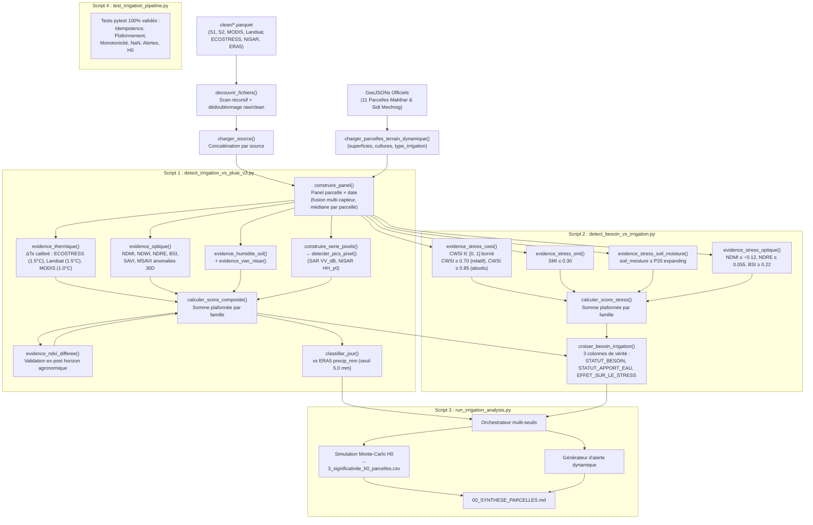

# 💧 Documentation Technique Exhaustive : Pipeline de Détection Irrigation vs Pluie vs Besoin en Eau — AWAM

**Projet :** AWAM  
**Sites d'étude :** Makthar (Gouvernorat de Siliana) & Sidi Mechreg (Gouvernorat de Bizerte)  
**Chemin du module :** `scripts/IRRIGATION/`  
**Scripts couverts :** `detect_irrigation_vs_pluie_v3.py`, `detect_besoin_vs_irrigation.py`, `run_irrigation_analysis.py`, `test_irrigation_pipeline.py`  
**Stage dans le Pipeline Master :** Stage 4  
**Modules transversaux :** `PIPELINE_MASTER/config_global.py` (chemins, bornes, chargeur GeoJSON), `PIPELINE_MASTER/registre_evenements_terrain.csv` (événements terrain)  
**Données sources :** Sorties `clean/*.parquet` de la pipeline d'extraction spatiale (GeoJSONs officiels : `parcelles_geojson/AWAM_TERRAIN_ALL_ALL_Boundaries_20250501_20260828_v1.0.geojson`)  
**Dernière mise à jour :** 31 Août 2026  

---

## 📑 Table des matières

1. [Vue d'ensemble & Objectifs](#1-vue-densemble--objectifs)
2. [Architecture complète & Diagramme de flux](#2-architecture-complète--diagramme-de-flux)
3. [Sources de données & Capteurs satellites](#3-sources-de-données--capteurs-satellites)
4. [Entrées & Métadonnées terrain dynamiques](#4-entrées--métadonnées-terrain-dynamiques)
5. [Script 1 — `detect_irrigation_vs_pluie_v3.py` : Détection physique d'apport d'eau](#5-script-1--detect_irrigation_vs_pluie_v3py)
   - 5.1 [Découverte automatique des fichiers (`decouvrir_fichiers`)](#51-découverte-automatique-des-fichiers)
   - 5.2 [Construction du panel multi-capteur (`construire_panel`)](#52-construction-du-panel-multi-capteur)
   - 5.3 [Facteur de dilution sub-pixel ($f_e$) (`facteur_echelle`)](#53-facteur-de-dilution-sub-pixel)
   - 5.4 [Module de pics pixel SAR/NISAR](#54-module-de-pics-pixel-sarnisar)
   - 5.5 [Preuves thermiques calibrées par capteur (`evidence_thermique`)](#55-preuves-thermiques-calibrées-par-capteur)
   - 5.6 [Preuves optiques — NDMI, NDWI, NDRE, BSI, SAVI, MSAVI](#56-preuves-optiques)
   - 5.7 [Preuves d'humidité du sol — NISAR](#57-preuves-dhumidité-du-sol)
   - 5.8 [Corroboration NDVI différée (Validation ex-post)](#58-corroboration-ndvi-différée-validation-ex-post)
   - 5.9 [Score composite & plafonnement par famille](#59-score-composite--plafonnement-par-famille)
   - 5.10 [Classification Pluie vs Irrigation (`classifier_jour`)](#510-classification-pluie-vs-irrigation)
6. [Script 2 — `detect_besoin_vs_irrigation.py` : Stress hydrique & Croisement](#6-script-2--detect_besoin_vs_irrigationpy)
   - 6.1 [Stress CWSI borné $[0, 1]$ (`evidence_stress_cwsi`)](#61-stress-cwsi-borné-0-1)
   - 6.2 [Stress SMI (`evidence_stress_smi`)](#62-stress-smi)
   - 6.3 [Stress humidité du sol NISAR](#63-stress-humidité-du-sol-nisar)
   - 6.4 [Stress optique relatif + absolu](#64-stress-optique-relatif--absolu)
   - 6.5 [Score de stress composite](#65-score-de-stress-composite)
   - 6.6 [Croisement Besoin ↔ Irrigation & Triple vérité](#66-croisement-besoin--irrigation--triple-vérité)
   - 6.7 [Simulation Monte-Carlo $H_0$ & Export CSV](#67-simulation-monte-carlo-h_0--export-csv)
7. [Script 3 — `run_irrigation_analysis.py` : Orchestrateur & Synthèse](#7-script-3--run_irrigation_analysispy)
8. [Script 4 — `test_irrigation_pipeline.py` : Suite de tests automatisés](#8-script-4--test_irrigation_pipelinepy)
9. [Dictionnaire complet des colonnes de sortie (CSV)](#9-dictionnaire-complet-des-colonnes-de-sortie)
10. [Guide d'utilisation (CLI & Pytest)](#10-guide-dutilisation-cli--pytest)

---

## 1. Vue d'ensemble & Objectifs

Cette pipeline répond à **trois questions agronomiques fondamentales** à partir de données de télédétection multi-capteurs :

1. **Quand une irrigation a-t-elle eu lieu ?** — Distinguer physiquement un apport d'eau artificiel d'un épisode pluvieux naturel en appliquant un seuil de pluie agronomique méditerranéen (`SEUIL_PLUIE_MM = 5.0 mm` sur 5 jours).
2. **Quand la plante en avait-elle besoin ?** — Identifier les périodes de stress hydrique (CWSI borné $[0, 1]$, SMI, NDMI, NDRE, BSI).
3. **Le stress s'est-il résorbé biologiquement ?** — Vérifier dans les 10 jours suivants si les indicateurs biologiques confirment une récupération végétale.

---

## 2. Architecture complète & Diagramme de flux



---

## 3. Calibrations Scientifiques Majeures

### 3.1 Seuil Pluviométrique Méditerranéen (`SEUIL_PLUIE_MM = 5.0 mm`)
Dans les climats semi-arides méditerranéens (Siliana/Bizerte), une pluie journalière $< 5\text{ mm}$ est largement interceptée par le feuillage et s'évapore immédiatement par évaporation directe du sol ($E_s$) sans reconstituer la réserve utile du sol ($RU$). Un cumul glissant $\ge 5\text{ mm}$ sur 5 jours est requis pour classer l'événement en `PLUIE_PROBABLE`.

### 3.2 Seuils de Refroidissement Thermique Différenciés par Capteur
Le refroidissement radiatif de surface $\Delta T_s = LST - T_{\max,\text{ERA5}}$ est calibré selon l'heure de passage et la résolution spatiale native :
- **ECOSTRESS-LST (70m, heure locale variable)** : `seuil_chute = 1.5°C`
- **Landsat-Thermal (30m/100m, passage 10h30)** : `seuil_chute = 1.5°C`
- **MODIS-LST (1000m, pixel agrégé)** : `seuil_chute = 1.0°C` (abaissement du seuil pour compenser la dilution sous-pixel).

### 3.3 Domaine de Validité CWSI $[0.0, 1.0]$
Dans `detect_besoin_vs_irrigation.py`, la fonction `evidence_stress_cwsi()` intègre une validation stricte :
- Les valeurs négatives dues au bruit radiométrique thermique sont tronquées à $0.0$.
- Les valeurs $> 1.0$ sont tronquées à $1.0$.

### 3.4 Corroboration NDVI Différée (Règle d'usage ML)
La corroboration NDVI post-irrigation est un **indicateur biologique ex-post** (évalué à $t + 5\text{j} \dots 14\text{j}$) confirmant la reprise végétative. Elle est documentée comme validation agronomique rétrospective et ne doit pas être utilisée comme prédicteur causal temps-réel à la date $t$.

### 3.5 Facteur de Dilution Sub-Pixel ($f_e$)
Le facteur d'échelle (`facteur_echelle()`) calcule la proportion de la parcelle couverte par un pixel satellite :

$$f_e = \max\left(0.15, \frac{\text{superficie parcelle (m}^2\text{)}}{\text{résolution pixel (m}^2\text{)}}\right)$$

- **Plancher** : $f_e \ge 0.15$ pour préserver le signal sur les très petites parcelles sans distorsion numérique.
- Utilisé par les scores de confiance des alertes et le plafonnement des preuves.

### 3.6 Gestion de la Pluie (`precip_mm`)
La précipitation est résolue selon la cascade :
1. Colonne `precip_mm` dans les données ERA5 (source primaire).
2. Fallback via l'API **Open-Meteo** si la colonne est absente.
3. **Jamais** $0\text{ mm}$ par défaut → marquage `INDETERMINE` si aucune source n'est disponible.

---

## 4. Orchestrateur (`run_irrigation_analysis.py`)

### 4.1 Option `--force-refresh`
Supprime **tous** les caches et résultats précédents avant de relancer :
- `outputs/irrigation/*.csv` et `*.md`
- `outputs/irrigation/tests_seuils/_cache_panel_*.pkl`
- `<data-dir>/cache_precip/` (cache météo Open-Meteo)
- `IRRIGATION/__pycache__/`

### 4.2 Simulation Monte-Carlo $H_0$
Pour chaque parcelle, le **taux de comblement observé** (jours de stress suivis d'irrigation / total jours de stress) est comparé à une distribution nulle $H_0$ générée par permutation aléatoire. Le seuil de signification statistique est $p_{95}$ :
- **Seuil de fiabilité** : `SEUIL_N_STRESS_FIABLE = 20` jours de stress minimum pour considérer le test comme statistiquement lisible.
- En dessous, chaque jour pèse $> 5\%$ et le verdict est marqué comme non fiable.

### 4.3 Vérification des événements connus
`_verifier_evenements_connus()` compare les détections d'irrigation aux événements déclarés dans `EVENEMENTS_CONNUS` (installation goutteurs Kemel/Yahia) avec une marge de ±10 à 21 jours.

---

## 5. Fichiers de Sortie Produits

| Fichier | Contenu |
|:---|:---|
| `rapport_irrigation_vs_pluie.csv` | Détections d'apports d'eau classifiées par jour et parcelle |
| `1_suivi_besoins_plante.csv` | Évaluation du stress hydrique et besoin en eau |
| `2_evaluation_apports_irrigation.csv` | Évaluation croisée besoin ↔ irrigation avec triple vérité |
| `3_significativite_h0_parcelles.csv` | Taux de comblement observé vs distribution nulle Monte-Carlo $H_0$ ($p_{95}$, verdict d'informativité) |
| `00_SYNTHESE_PARCELLES.md` | Synthèse d'aide à la décision agronomique |

---

## 6. Guide d'Utilisation CLI

```bash
# Détection complète sur toute la période
python scripts/IRRIGATION/run_irrigation_analysis.py --data-dir scripts/outputs/pixel_indices_database/clean

# Mode dry-run (validation sans écriture CSV)
python scripts/IRRIGATION/detect_irrigation_vs_pluie_v3.py --dry-run

# Nettoyage complet et recalcul depuis les parquets bruts
python scripts/IRRIGATION/run_irrigation_analysis.py --data-dir <chemin> --force-refresh

# Tests automatisés
python -m pytest scripts/IRRIGATION/test_irrigation_pipeline.py -v
```