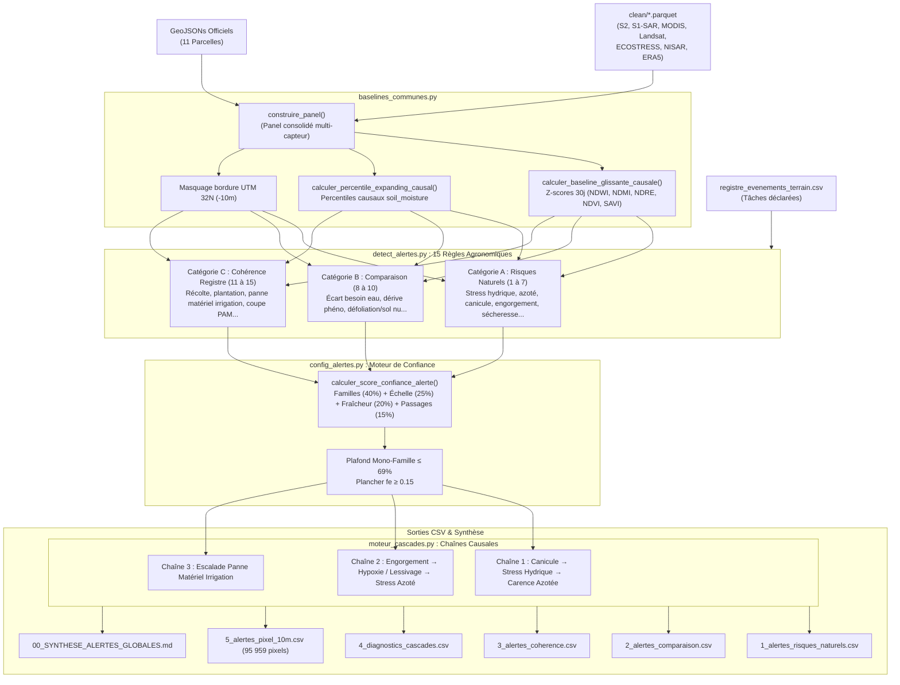

# 🚨 Documentation Méthodologique & Technique : Module Autonome d'Alertes Multi-Sources (`MODULE_ALERTES`)

**Projet :** AWAM  
**Sites d'étude :** Makthar (Gouvernorat de Siliana) & Sidi Mechreg (Gouvernorat de Bizerte)  
**Chemin du module :** `scripts/MODULE_ALERTES/`  
**Scripts couverts :** `config_alertes.py`, `baselines_communes.py`, `detect_alertes.py`, `moteur_cascades.py`, `run_alertes_pipeline.py`, `test_alertes_pipeline.py`  
**Stage dans le Pipeline Master :** Stage 5  
**Modules transversaux :** `PIPELINE_MASTER/config_global.py`, `PIPELINE_MASTER/pipeline_logging.py`, `PIPELINE_MASTER/schema_validator.py`, `PIPELINE_MASTER/registre_evenements_terrain.csv`  
**Données sources :** Base `scripts/outputs/pixel_indices_database/clean/*.parquet` (S2, S1, MODIS-LST, ECOSTRESS, NISAR, ERA5)  
**Dernière mise à jour :** 20 Septembre 2026  

---

## 📑 Table des matières

1. [Vue d'ensemble & Philosophie](#1-vue-densemble--philosophie)
2. [Architecture Complète & Diagramme de Flux](#2-architecture-complète--diagramme-de-flux)
3. [Fondations Méthodologiques & Score de Confiance](#3-fondations-méthodologiques--score-de-confiance)
   - 3.1 [Découplage Orthogonal en 3 Axes](#31-découplage-orthogonal-en-3-axes)
   - 3.2 [Calcul Explicite du Score de Confiance (0 à 100%)](#32-calcul-explicite-du-score-de-confiance-0-à-100)
   - 3.3 [Règle Absolue du Plafond Mono-Famille (69%)](#33-règle-absolue-du-plafond-mono-famille-69)
   - 3.4 [Plancher de Facteur d'Échelle ($f_e \ge 0.15$)](#34-plancher-de-facteur-déchelle-f_e-ge-015)
   - 3.5 [Gestion Robuste de l'Absence de Pluie](#35-gestion-robuste-de-labsence-de-pluie)
4. [Matrice Exhaustive des 15 Alertes Agronomiques](#4-matrice-exhaustive-des-15-alertes-agronomiques)
   - 4.1 [Catégorie A : Risques Naturels & Stress Biophysiques (7 Alertes)](#41-catégorie-a--risques-naturels--stress-biophysiques-7-alertes)
   - 4.2 [Catégorie B : Comparaison Satellite vs Référentiel Déclaré (3 Alertes)](#42-catégorie-b--comparaison-satellite-vs-référentiel-déclaré-3-alertes)
   - 4.3 [Catégorie C : Cohérence Registre Terrain vs Réponse Végétale (5 Alertes)](#43-catégorie-c--cohérence-registre-terrain-vs-réponse-végétale-5-alertes)
5. [Moteur de Cascades Causales Temporelles (`moteur_cascades.py`)](#5-moteur-de-cascades-causales-temporelles-moteur_cascadespy)
6. [Alignement Spatio-Temporel & Détection Pixel 10m](#6-alignement-spatio-temporel--détection-pixel-10m)
7. [Fichiers de Sortie Produits](#7-fichiers-de-sortie-produits)
8. [Guide d'Utilisation (CLI & Pytest)](#8-guide-dutilisation-cli--pytest)

---

## 1. Vue d'ensemble & Philosophie

Le `MODULE_ALERTES` constitue le moteur autonome d'aide à la décision agronomique du projet **AWAM**. Il analyse les signaux multi-capteurs pour identifier, qualifier, hiérarchiser et relier causalement l'ensemble des anomalies culturales et opérationnelles.

Il s'appuie sur une stricte **indépendance des preuves**, un **calcul de confiance transparent**, et une **traçabilité complète** avec le registre d'interventions terrain.

---

## 2. Architecture Complète & Diagramme de Flux



---

## 3. Fondations Méthodologiques & Score de Confiance

### 3.1 Découplage Orthogonal en 3 Axes
Chaque alerte est qualifiée sur **3 dimensions totalement indépendantes** :

1. **`score_confiance` $\in [0, 100\%]$ & `niveau_confiance` (`HAUTE`, `MOYENNE`, `BASSE`)** : Mesure uniquement la robustesse métrologique de la détection (nombre de familles physiques corroborantes, résolution spatiale, fraîcheur temporelle).
2. **`gravite` (`INFORMATION`, `AVERTISSEMENT`, `CRITIQUE`)** : Mesure l'urgence et l'impact agronomique sur la culture.
3. **`statut_cascade` (`ISOLEE`, `CHAINE_TEMPORELLEMENT_COHERENTE`, `CORRELATION_TEMPORELLE_NON_CONFIRMEE`, `CRITIQUE_CASCADANTE`)** : Explicite le positionnement de l'alerte dans une séquence causale temporelle.

### 3.2 Calcul Explicite du Score de Confiance (0 à 100%)

$$\text{Score Confiance} = 40\% \times S_{\text{familles}} + 25\% \times S_{\text{échelle}} + 20\% \times S_{\text{fraîcheur}} + 15\% \times S_{\text{multi-passage}}$$

- **Familles de capteurs** ($S_{\text{familles}}$) :
  - 1 famille : 50 pts
  - 2 familles : 80 pts
  - 3+ familles : 100 pts
- **Facteur d'échelle** ($S_{\text{échelle}} = f_e \times 100$) : Ratio surface parcelle / résolution capteur.
- **Fraîcheur des données** ($S_{\text{fraîcheur}}$) : Décroissance exponentielle selon l'âge du dernier passage satellite.
- **Multi-passage** ($S_{\text{multi-passage}}$) : Bonus de persistance temporelle sur 2 passages successifs.

### 3.3 Règle Absolue du Plafond Mono-Famille (69%)
> [!IMPORTANT]
> Si une alerte ne repose que sur **une seule famille de capteur** ($n_{\text{familles}} = 1$, par ex. uniquement optique ou uniquement thermique), son score de confiance total est **strictement plafonné à $69\%$** (`MOYENNE`), quel que soit l'alignement des autres sous-scores. Le niveau `HAUTE` ($\ge 70\%$) exige impérativement une corroboration multi-capteurs multi-familles.

### 3.4 Plancher de Facteur d'Échelle ($f_e \ge 0.15$)
Pour éviter une dégradation excessive de confiance sur les très petites parcelles (ex: parcelles aromatiques de 0.2 ha observées par MODIS 1000m ou NISAR 200m), le facteur d'échelle est borné inférieurement par $f_e \ge 0.15$.

### 3.5 Gestion Robuste de l'Absence de Pluie
L'absence de pluie est vérifiée au niveau de **chaque observation individuelle**. Si la donnée de précipitation est absente (`NaN` ou non fournie), les alertes dépendantes de la pluie (ex: Alerte 5 Engorgement, Alerte 6 Sécheresse) reçoivent le garde-fou explicite `INDETERMINE` et ne supposent jamais $0\text{ mm}$ par défaut.

---

## 4. Matrice Exhaustive des 15 Alertes Agronomiques

### 4.1 Catégorie A : Risques Naturels & Stress Biophysiques (7 Alertes)

| ID | Type d'Alerte | Conditions de Déclenchement & Formules | Gravité & Garde-fous Topographiques |
|:---:|:---|:---|:---|
| **#1** | `ALERTE_1_STRESS_HYDRIQUE` | ($Z_{\text{NDWI}} \le -1.5$ ou $Z_{\text{NDMI}} \le -1.5$) ET ($CWSI \ge 0.40$ ou $SM_{\text{pct}} \le 20\%$) | `CRITIQUE` si jeunes plants / arboriculture, sinon `AVERTISSEMENT`. Masqué si sol nu ($fCover < 0.05$). |
| **#2** | `ALERTE_2_STRESS_AZOTE_FORT` | $Z_{\text{NDRE}} \le -1.5$ ou $Z_{\text{CI\_RedEdge}} \le -1.5$, avec $Z_{\text{NDWI}} \ge -0.5$ (signaux eau stables). | `AVERTISSEMENT`. Exclusion mutuelle : si stress hydrique simultané, bascule vers #3. |
| **#3** | `ALERTE_3_STRESS_COMBINE_EAU_AZOTE` | Co-occurrence simultanée d'un stress hydrique (#1) et d'une chute chlorophylle ($Z_{\text{NDRE}} \le -1.2$). | `CRITIQUE`. Priorité agronomique maximale (double déficit). |
| **#4** | `ALERTE_4_STRESS_THERMIQUE_CANICULE` | $T_{\max,\text{corrigée}} \ge 35^\circ\text{C}$ ou $LST_{\text{MODIS/ECOSTRESS}} \ge 40^\circ\text{C}$. | `CRITIQUE` si $T_{\max,\text{eff}} \ge 38^\circ\text{C}$. **Topographie** : $T_{\max}$ débiaisée par lapse rate ($-6.5^\circ\text{C/km}$) + amplification versant Sud (**Adret** $+0.5^\circ\text{C}$). |
| **#5** | `ALERTE_5_EXCES_HUMIDITE_ENGORGEMENT` | $Z_{\text{NDWI}} \ge 1.5$ et $P_{\text{cumul}} \ge 40\text{mm}$ (abaissé à $\ge 25\text{mm}$ pour $TWI \ge 8.5$). | `AVERTISSEMENT`. Risque d'asphyxie racinaire et maladies fongiques accru en bas-fond / cuvette. `INDETERMINE` si pluie manquante. |
| **#6** | `ALERTE_6_SECHERESSE_PROLONGEE` | Durée sans pluie $\ge 21\text{j}$ consécutifs ET ($Z_{\text{NDVI}} \le -1.0$ ou $Z_{\text{SAVI}} \le -1.0$). | `CRITIQUE` si $\ge 30\text{j}$, sinon `AVERTISSEMENT`. `INDETERMINE` si pluie manquante. |
| **#7** | `ALERTE_7_ANOMALIE_NON_ATTRIBUEE` | Hétérogénéité intra-parcellaire : $Z_{\text{spatial}} \le -2.0$ ou $\Delta \le -20\%$ par rapport à la médiane parcelle. | `AVERTISSEMENT`. Masquage de bordure $-10\text{m}$ obligatoire. |

### 4.2 Catégorie B : Comparaison Satellite vs Référentiel Déclaré (3 Alertes)

| ID | Type d'Alerte | Conditions de Déclenchement | Description & Qualification |
|:---:|:---|:---|:---|
| **#8** | `ALERTE_8_ECART_EAU_REEL_VS_BESOIN` | Stress hydrique avéré ($CWSI \ge 0.70$ ou $Z_{\text{NDMI}} \le -1.5$) sans apport d'eau (ni pluie $\ge 5\text{mm}$ ni irrigation). | Déficit d'apport d'eau non comblé face au besoin biologique de la culture. |
| **#9** | `ALERTE_9_ECART_STADE_PHENOLOGIQUE` | Score de suivi phénologique $< 50/100$ vs calendrier prévisionnel de la culture. | Retard végétatif ou sénescence précoce anormale. |
| **#10** | `ALERTE_10_ECART_OCCUPATION_REELLE_VS_DECLAREES` | $Z_{\text{NDVI}} \le -1.5$ ou $fCover < 0.05$ sur parcelle déclarée en pleine végétation. | Qualifié en Défoliation ($Z \le -1.5$), Sol Nu ($fCover < 0.05$), ou Couvert Clairsemé. |

### 4.3 Catégorie C : Cohérence Registre Terrain vs Réponse Végétale (5 Alertes)

| ID | Type d'Alerte | Événement Terrain Déclaré | Réponse Satellite Observée & Diagnostic |
|:---:|:---|:---|:---|
| **#11** | `ALERTE_11_RECOLTE_DESHERBAGE_SANS_CHANGEMENT` | `DESHERBAGE` ou `RECOLTE` | Absence de chute de biomasse ($\Delta NDVI > -0.05$) à $J+5 \dots J+15$. |
| **#12** | `ALERTE_12_PLANTATION_SANS_LEVEE` | `PLANTATION` ou `SEMIS` | Absence de levée végétale ($\Delta SAVI < +0.03$ et $fCover < 0.08$) après 15 à 60 jours. |
| **#13** | `ALERTE_13_IRRIGATION_SANS_REPONSE_HYDRIQUE` | `IRRIGATION` déclarée au registre | Absence de signal d'humidité ($\Delta NDWI < +0.05$, pas de refroidissement $\Delta Ts$). $\to$ **Diagnostic : Panne réseau / goutteurs bouchés**. |
| **#14** | `ALERTE_14_COUPE_PAM_SANS_SAUT_NDVI` | `COUPE_PAM` (Plantes Aromatiques) | Absence de rupture de biomasse nette ($\Delta NDVI > -0.10$). |
| **#15** | `ALERTE_15_CHANGEMENT_DETECTE_SANS_TACHE` | Aucune intervention déclarée | Couvert par détection combinée #7 / #10 (changement spectral sans tâche associée). |

---

## 5. Moteur de Cascades Causales Temporelles (`moteur_cascades.py`)

Le moteur de cascades lie les alertes successives pour identifier les enchaînements agronomiques récurrents :

```
┌─────────────────────────────────────────────────────────────────────────────┐
│ CHAÎNE 1 : Choc Thermique → Déficit Hydrique → Carence Azotée               │
│ [Alerte 4 : Canicule] ──(≤10j)──► [Alerte 1/3 : Stress Hydrique] ──(7-21j)──► [Alerte 2 : Carence Azotée] │
└─────────────────────────────────────────────────────────────────────────────┘

┌─────────────────────────────────────────────────────────────────────────────┐
│ CHAÎNE 2 : Engorgement Pluvial → Hypoxie Racinaire → Carence Post-Pluie     │
│ [Alerte 5 : Engorgement] ──────────(5-20j post-pluie)──────────► [Alerte 2 : Stress Azoté / Lessivage] │
└─────────────────────────────────────────────────────────────────────────────┘

┌─────────────────────────────────────────────────────────────────────────────┐
│ CHAÎNE 3 : Escalade Panne Matériel d'Irrigation                             │
│ [Alerte 13 : Irrigation sans Réponse] ──(simultané)──► [Alerte 8 : Besoin Non Comblé] │
└─────────────────────────────────────────────────────────────────────────────┘
```

Chaque alerte liée se voit attribuer :
- `statut_cascade` = `CHAINE_TEMPORELLEMENT_COHERENTE`
- `chaine_id` $\in \{1, 2, 3\}$
- `noeud_precedent` : Référence de l'alerte causale amont avec sa date exacte.
- `diagnostic_texte` : Explication agronomique complète de l'enchaînement.

---

## 6. Alignement Spatio-Temporel & Détection Pixel 10m

- **Grille Canonique 10m** : Sentinel-2 sert de référence spatiale (`EPSG:32632`, UTM 32N).
- **Interpolation multi-résolution k-d Tree** : Les capteurs basse résolution (MODIS-LST 1000m, NISAR 200m) sont projetés sur la grille 10m avec conservation du facteur d'échelle.
- **Masquage de bordure intra-parcellaire (-10m)** : Élimine les effets mixtes de lisières, chemins et bordures de parcelles.
- **Sortie Haute Résolution** : `5_alertes_pixel_10m.csv` contient l'ensemble des 92 011 points d'échantillonnage pixel.

---

## 7. Fichiers de Sortie Produits

| Fichier | Catégorie / Rôle | Contenu & Structure |
|:---|:---|:---|
| `1_alertes_risques_naturels.csv` | Catégorie A | Alertes 1 à 7 (Stress eau, azote, thermique, engorgement, anomalies) |
| `2_alertes_comparaison.csv` | Catégorie B | Alertes 8 à 10 (Écart besoin, phénologie, occupation) |
| `3_alertes_coherence.csv` | Catégorie C | Alertes 11 à 15 (Cohérence tâches terrain vs satellite) |
| `4_diagnostics_cascades.csv` | Causalité | Enchaînements causaux temporels (Chaînes 1, 2, 3) |
| `5_alertes_pixel_10m.csv` | Spatial 10m | Détections fines désagrégées au pixel (95 959 lignes — run 20/09/2026) |
| `00_SYNTHESE_ALERTES_GLOBALES.md` | Synthèse | Rapport d'alerte agronomique exécutif complet |

---

## 8. Guide d'Utilisation (CLI & Pytest)

```bash
# Exécution autonome complète du module d'alertes
python scripts/MODULE_ALERTES/run_alertes_pipeline.py

# Exécution avec purge totale des caches
python scripts/MODULE_ALERTES/run_alertes_pipeline.py --force-refresh

# Exécution via le Pipeline Master (Stage 5)
python scripts/PIPELINE_MASTER/run_master_pipeline.py --skip-extract --skip-vari --skip-sante --skip-irrigation

# Suite de tests unitaires et d'intégration
python -m pytest scripts/MODULE_ALERTES/test_alertes_pipeline.py -v
```
