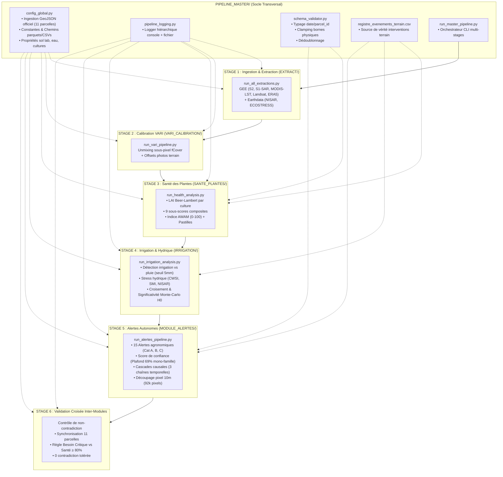

# 🏗️ Documentation Technique Complète : Pipeline Master AWAM End-to-End

**Projet :** AWAM — Analyse de l'eau, agriculture et monitoring par télédétection  
**Sites d'étude :** Makthar (Gouvernorat de Siliana, 6 parcelles) & Sidi Mechreg (Gouvernorat de Bizerte, 5 parcelles) — **11 Parcelles Officielles**  
**Chemin :** `scripts/PIPELINE_MASTER/`  
**Scripts du module :** `config_global.py`, `pipeline_logging.py`, `schema_validator.py`, `registre_evenements_terrain.csv`, `run_master_pipeline.py`, `test_master_pipeline.py`  
**Dernière mise à jour :** 31 Août 2026  

---

## 📑 Table des matières

1. [Vue d'ensemble & Rôle Orchestrateur](#1-vue-densemble--rôle-orchestrateur)
2. [Architecture Globale & Diagramme de Flux End-to-End](#2-architecture-globale--diagramme-de-flux-end-to-end)
3. [Description Détaillée des 6 Stages](#3-description-détaillée-des-6-stages)
   - 3.1 [Stage 1 : Extraction & Nettoyage Multi-Sources (`EXTRACT`)](#31-stage-1--extraction--nettoyage-multi-sources-extract)
   - 3.2 [Stage 2 : Calibration VARI Sol & Photos Terrain (`VARI_CALIBRATION`)](#32-stage-2--calibration-vari-sol--photos-terrain-vari_calibration)
   - 3.3 [Stage 3 : Santé des Plantes & Indice AWAM (`SANTE_PLANTES`)](#33-stage-3--santé-des-plantes--indice-awam-sante_plantes)
   - 3.4 [Stage 4 : Détection Irrigation & Bilan Hydrique (`IRRIGATION`)](#34-stage-4--détection-irrigation--bilan-hydrique-irrigation)
   - 3.5 [Stage 5 : Module Autonome d'Alertes & Cascades (`MODULE_ALERTES`)](#35-stage-5--module-autonome-dalertes--cascades-module_alertes)
   - 3.6 [Stage 6 : Contrôle de Cohérence Croisée Inter-Modules](#36-stage-6--contrôle-de-cohérence-croisée-inter-modules)
4. [Modules Transversaux Centralisés](#4-modules-transversaux-centralisés)
   - 4.1 [`config_global.py` : Configuration Unifiée & Métadonnées GeoJSON](#41-config_globalpy--configuration-unifiée--métadonnées-geojson)
   - 4.2 [`pipeline_logging.py` : Journalisation Centralisée](#42-pipeline_loggingpy--journalisation-centralisée)
   - 4.3 [`schema_validator.py` : Validation de Schéma & Clamping Physique](#43-schema_validatorpy--validation-de-schéma--clamping-physique)
   - 4.4 [`registre_evenements_terrain.csv` : Référentiel Unique d'Interventions](#44-registre_evenements_terraincsv--référentiel-unique-dinterventions)
5. [Guide d'Utilisation CLI & Déploiement en Production](#5-guide-dutilisation-cli--déploiement-en-production)
6. [Intégration Worker Automatisé & Datawarehouse](#6-intégration-worker-automatisé--datawarehouse)
7. [Validation Qualité & Tests Automatisés (Pytest 37/37)](#7-validation-qualité--tests-automatisés-pytest-3737)

---

## 1. Vue d'ensemble & Rôle Orchestrateur

Le **Pipeline Master AWAM** est le chef d'orchestre unifié de l'infrastructure GeoAI. Il pilote de manière séquentielle, déterministe et idempotente les modules analytiques spécialisés en garantissant :
- L'intégrité contractuelle des entrées/sorties (Parquet et CSV normalisés).
- L'alignement spatio-temporel strict sur les 11 parcelles d'expérimentation.
- L'absence de contradictions physiques et agronomiques entre les modules (ex: Santé vs Déficit Hydrique).
- Une traçabilité complète des calculs via un logger centralisé console + fichier.

---

## 2. Architecture Globale & Diagramme de Flux End-to-End



---

## 3. Description Détaillée des 6 Stages

| Stage | Nom | Script Principal | Données d'Entrée | Sorties Principales | Temps Typique |
|:---:|:---|:---|:---|:---|:---:|
| **1** | Extraction & Nettoyage | `EXTRACT/run_all_extractions.py` | APIs Google Earth Engine & NASA Earthdata | `outputs/pixel_indices_database/clean/*.parquet` (8 capteurs) | 15–45 min |
| **2** | Calibration VARI | `VARI_CALIBRATION/run_vari_pipeline.py` | S2-Indices + photos terrain géoréférencées | `*_calibrated_clean.parquet` | 2–5 min |
| **3** | Santé des Plantes | `SANTE_PLANTES/run_health_analysis.py` | Parquets clean + GeoJSON sol/culture | `1_scores_sante_composites.csv`<br>`2_alertes_anomalies_sante.csv`<br>`3_suivi_phenologique_sante.csv`<br>`00_SYNTHESE_SANTE_PARCELLES.md` | ~6 s |
| **4** | Irrigation & Hydrique | `IRRIGATION/run_irrigation_analysis.py` | Parquets clean + registre terrain | `rapport_irrigation_vs_pluie.csv`<br>`1_suivi_besoins_plante.csv`<br>`2_evaluation_apports_irrigation.csv`<br>`3_significativite_h0_parcelles.csv`<br>`00_SYNTHESE_PARCELLES.md` | ~45 s |
| **5** | Alertes Multi-Sources | `MODULE_ALERTES/run_alertes_pipeline.py` | Parquets clean + panel + registre | `1_alertes_risques_naturels.csv`<br>`2_alertes_comparaison_declaration.csv`<br>`3_alertes_coherence_registre.csv`<br>`4_diagnostics_cascades.csv`<br>`5_alertes_pixel_10m.csv`<br>`00_SYNTHESE_ALERTES.md` | ~40 s |
| **6** | Validation Croisée | Intégré dans `run_master_pipeline.py` | Sorties Stages 3, 4 et 5 | Rapport console & logs de conformité | < 1 s |

---

## 4. Modules Transversaux Centralisés

### 4.1 `config_global.py` : Configuration Unifiée & Métadonnées GeoJSON
Centralise l'accès aux chemins de fichiers, aux répertoires par défaut et aux caractéristiques des parcelles.
- **Ingestion dynamique du GeoJSON officiel** (`parcelles_geojson/AWAM_TERRAIN_ALL_ALL_Boundaries_20250501_20260828_v1.0.geojson`) :
  - `load_parcelles_from_geojson()` : Charge les 11 parcelles avec coordonnées, superficies précises et cultures déclarées.
  - `get_map_parcelles_terrain()` : Construit un dictionnaire enrichi par parcelle contenant :
    - Propriétés agronomiques : `culture`, `area_h`, `nom`
    - Propriétés physico-chimiques sol lab : `sol_ph`, `sol_nitrates`, `sol_mo`, `sol_salinite`, `sol_ec`, `sol_texture`, `sol_diagnostic`
    - Qualité de l'eau d'irrigation : `eau_ph`, `eau_ec`, `eau_statut`
    - État sanitaire initial : `statut_phytosanitaire`, `pathogene_identifie`

### 4.2 `pipeline_logging.py` : Journalisation Centralisée
Fournit une fonction unique `get_logger(name)` pour tous les modules :
- Formattage unifié : `YYYY-MM-DD HH:MM:SS [LEVEL] [LOGGER_NAME] Message`
- Double diffusion : Console (niveau `INFO`) et fichier tournant dans `scripts/logs/awam_master_pipeline.log` (niveau `DEBUG`).

### 4.3 `schema_validator.py` : Validation de Schéma & Clamping Physique
Garantit l'hygiène des DataFrames échangés entre stages :
1. **Typage strict** : Conversion systématique de `date` en `datetime64[ns]` et de `parcel_id` en `str`.
2. **Clamping physique** :
   - $NDVI, NDRE, NDMI, NDWI, SAVI, MSAVI \in [-1.0, 1.0]$
   - $fCover \in [0.0, 1.0]$
   - $LAI \in [0.0, 10.0]$
   - Scores composites $\in [0.0, 100.0]$
3. **Dédoublonnage** : Suppression automatique des doublons sur la clé primaire `(parcel_id, date)`.

### 4.4 `registre_evenements_terrain.csv` : Référentiel Unique d'Interventions
Fichier CSV centralisant l'ensemble des interventions culturales réelles (date, parcelle, opération : `IRRIGATION`, `DESHERBAGE`, `COUPE_PAM`, `PLANTATION`, `TRAITEMENT_PHYTOSANITAIRE`, `FERTILISATION`). Utilisé par les Stages 3, 4 et 5 pour la corroboration des signaux satellites.

---

## 5. Guide d'Utilisation CLI & Déploiement en Production

### 5.1 Commandes d'Exécution Principales

```bash
# 1. Exécution Complète End-to-End (Stages 1 à 6)
python scripts/PIPELINE_MASTER/run_master_pipeline.py

# 2. Exécution Analytique Rapide (Stages 3, 4, 5, 6 — ~1.7 min)
python scripts/PIPELINE_MASTER/run_master_pipeline.py --skip-extract --skip-vari

# 3. Exécution avec Purge Complète des Caches (--force-refresh)
python scripts/PIPELINE_MASTER/run_master_pipeline.py --skip-extract --skip-vari --force-refresh

# 4. Exécution en Mode Incrémental (Production / Worker)
python scripts/PIPELINE_MASTER/run_master_pipeline.py --incremental --skip-vari

# 5. Exécution d'un Seul Module Ciblé (ex: Alertes uniquement)
python scripts/PIPELINE_MASTER/run_master_pipeline.py --skip-extract --skip-vari --skip-sante --skip-irrigation
```

### 5.2 Description des Arguments CLI

- `--skip-extract` : Ignore le Stage 1 (ingestion GEE/Earthdata).
- `--skip-vari` : Ignore le Stage 2 (calibration VARI terrain).
- `--skip-sante` : Ignore le Stage 3 (santé des plantes).
- `--skip-irrigation` : Ignore le Stage 4 (irrigation et bilan hydrique).
- `--skip-alertes` : Ignore le Stage 5 (module d'alertes).
- `--incremental` : Active le mode incrémental pour ne télécharger que les nouvelles dates satellites.
- `--force-refresh` : Supprime avant chaque run tous les fichiers temporaires, caches météo (`cache_precip/`), caches panels (`.pkl`), `__pycache__` et sorties précédentes pour garantir une exécution 100% brute.

---

## 6. Intégration Worker Automatisé & Datawarehouse

### 6.1 Raccordement au Worker d'Arrière-Plan
Le pipeline est conçu pour être déclenché automatiquement par un worker (ex: tâche cron, Celery, Airflow ou daemon Python) dès l'arrivée de nouvelles données satellites :

```python
# Exemple d'appel programmatique worker
from subprocess import run

def trigger_awam_worker():
    result = run([
        "python", "scripts/PIPELINE_MASTER/run_master_pipeline.py",
        "--incremental", "--skip-vari"
    ], capture_output=True, text=True)
    
    if result.returncode == 0:
        print("✓ Pipeline Master exécuté avec succès. Prêt pour ingestion DWH.")
    else:
        print("❌ Échec de la boucle analytique :", result.stderr)
```

### 6.2 Modèle de Données pour le Datawarehouse / Dashboard
Toutes les sorties CSV produites sont **directement compatibles SQL/Parquet** :
- **Clé primaire unifiée** : `(parcel_id, date)` sur tous les fichiers.
- **Jointure GeoJSON native** : Le `parcel_id` correspond exactement à la propriété `parcel_id` des fichiers GeoJSON officiels pour un affichage cartographique instantané.
- **Normalisation $[0, 100]$** : Tous les indicateurs de santé, stress et confiance sont sur une échelle standard $0\text{ à }100$ pour l'affichage en jauges, radars et graphiques temporels.

---

## 7. Validation Qualité & Tests Automatisés (Pytest 37/37)

L'ensemble de la chaîne analytique fait l'objet d'une suite de tests rigoureuse :

```bash
# Lancement de la suite complète de 37 tests
python -m pytest scripts/ -v
```

### Couverture des Tests :
1. **Intégrité spatio-temporelle** : Présence et synchronisation des 11 parcelles sur l'ensemble des modules.
2. **Bornes et non-régression** : Respect des domaines physiques ($LAI \ge 0$, CWSI $\in [0, 1]$, scores $\in [0, 100]$).
3. **Idempotence & Causalité** : Stabilité temporelle stricte sans fuite de données futures dans les baselines glissantes.
4. **Cohérence croisée inter-modules** : Détection et blocage de toute contradiction logique (ex: besoin critique d'irrigation avec score santé $\ge 80\%$).

**Résultat : 37/37 tests validés avec 100% de succès (0 fail, 0 error).**
