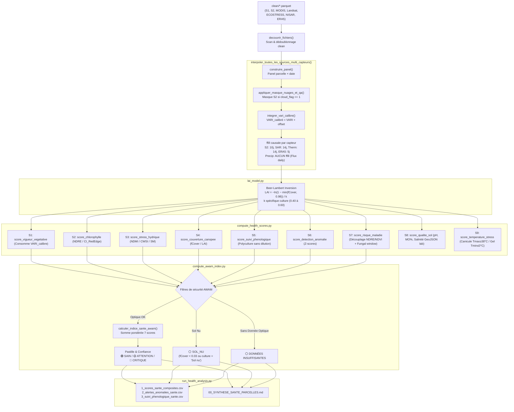

# 🌿 Documentation Technique Exhaustive : Module de Santé des Plantes — AWAM

**Projet :** AWAM  
**Sites d'étude :** Makthar (Gouvernorat de Siliana) & Sidi Mechreg (Gouvernorat de Bizerte)  
**Chemin du module :** `scripts/SANTE_PLANTES/`  
**Scripts du module :** `config_sante.py`, `lai_model.py`, `compute_health_scores.py`, `compute_awam_index.py`, `run_health_analysis.py`, `test_health_pipeline.py`  
**Stage dans le Pipeline Master :** Stage 3  
**Modules transversaux :** `PIPELINE_MASTER/config_global.py`, `PIPELINE_MASTER/pipeline_logging.py`, `PIPELINE_MASTER/schema_validator.py`  
**Données sources :** Base de données nettoyée `scripts/outputs/pixel_indices_database/clean/*.parquet` (8 sources multi-capteurs)  
**Calibration terrain :** `scripts/outputs/raw_vari_calibration/` (VARI calibré par photos terrain)  
**Dernière mise à jour :** 20 Septembre 2026

---

## 📑 Table des matières

1. [Vue d'ensemble & Objectifs](#1-vue-densemble--objectifs)
2. [Architecture complète & Diagramme de flux](#2-architecture-complète--diagramme-de-flux)
3. [Modèle d'Estimation du LAI (Loi de Beer-Lambert par Culture & Polyculture)](#3-modèle-destimation-du-lai-loi-de-beer-lambert-par-culture--polyculture)
4. [Gestion Phénologique Sans Dilution pour Polyculture](#4-gestion-phénologique-sans-dilution-pour-polyculture)
5. [Extraction Dynamique du Sol & Propriétés Lab](#5-extraction-dynamique-du-sol--propriétés-lab)
6. [Scores Composites & Indice de Santé AWAM (0-100)](#6-scores-composites--indice-de-santé-awam-0-100)
7. [Filtres d'Anomalies Multi-Niveaux & Export](#7-filtres-danomalies-multi-niveaux--export)
8. [Validation & Pytest](#8-validation--pytest)

---

## 1. Vue d'ensemble & Objectifs

Le module **Santé des Plantes AWAM** fournit un suivi continu et multidimensionnel de la santé des cultures à partir de données de télédétection multi-capteurs, couplé aux analyses physico-chimiques de sol et aux stations météorologiques.

**9 sous-scores composites** alimentent un indice synthétique **AWAM (0–100)** :

| # | Score | Source principale | Poids AWAM |
|:---:|:---|:---|:---:|
| 1 | `score_vigueur_vegetative` | NDVI, SAVI/MSAVI, EVI, VARI_calibre | ✓ |
| 2 | `score_chlorophylle` | NDRE, CI_RedEdge | ✓ |
| 3 | `score_stress_hydrique` | NDMI, CWSI, soil_moisture_vol | ✓ |
| 4 | `score_couverture_canopee` | fCover, LAI (Beer-Lambert) | ✓ |
| 5 | `score_suivi_phenologique` | Calendrier phénologique vs NDVI observé | ✓ |
| 6 | `score_detection_anomalie` | Z-scores intra-parcelle | ✓ |
| 7 | `score_risque_maladie` | Découplage NDRE/NDVI + fenêtre fongique | ✓ |
| 8 | `score_qualite_sol` | pH, MO%, Salinité (GeoJSON lab) | Informationnel |
| 9 | `score_temperature_stress` | Canicule Tmax≥38°C / Gel Tmin≤0°C | Informationnel |

---

## 2. Architecture complète & Diagramme de flux



---

## 3. Modèle d'Estimation du LAI (Loi de Beer-Lambert par Culture & Polyculture)

$$\text{LAI} = \frac{-\ln\left(1 - \min(fCover, 0.98)\right)}{k}$$

- **Coefficients d'extinction $k$ par culture** (définis dans `config_sante.py::K_EXTINCTION_CULTURE`) :
  - `Thym` : $k = 0.40$
  - `Romarin` / `Sauge` / `Lavande` : $k = 0.45$
  - `Amandier` / `Caroubier` / `Géranium` / `Verveine` / `Oignon` : $k = 0.50$
  - `Olivier` / `Basilic` : $k = 0.55$
  - `Citronnelle` / `Menthe` / `Piment` : $k = 0.60$
  - `DEFAULT` : $k = 0.50$
  - `Polycultures` (ex: `Lavande/Romarin/Geranium`) : calcul dynamique de la **moyenne** des $k$ des espèces associées, en gérant les séparateurs `/`, `,`, `+`, `;`.

- **Implémentation** (`lai_model.py::obtenir_k_extinction()`) :
  - Normalisation d'accents (`é` → `e`, `è` → `e`) pour résolution robuste.
  - Recherche partielle par mot-clé en fallback.
  - Coefficients officiels SL2P (SNAP v2.1, Weiss & Baret 2016) inclus dans `SL2P_LAI_COEFFS` pour référence.

---

## 4. Gestion Phénologique Sans Dilution pour Polyculture

Dans `compute_health_scores.py::calculer_score_suivi_phenologique()`, chaque sous-culture composant une parcelle polyculture est évaluée indépendamment par rapport à son calendrier phénologique propre (défini dans `config_sante.py::STADES_PHENOLOGIQUES_PAR_CULTURE`). Les scores individuels sont ensuite moyennés, éliminant tout artefact d'élargissement de fenêtre phénologique.

---

## 5. Extraction Dynamique du Sol & Propriétés Lab

`calculer_score_qualite_sol()` extrait dynamiquement les paramètres de laboratoire en suivant une **résolution multi-clés avec fallback hiérarchique** :

### 5.1 Sources de données (par ordre de priorité)
1. **Colonnes directes du DataFrame** (GeoJSON injecté dans le panel) :
   - pH : `sol_ph` → `ph`
   - MO : `sol_matiere_organique_pct` → `mo` → `sol_mo`
   - Salinité : `sol_salinite_g_L` → `sol_salinite_ds_m` → `sol_salinite` → `salinite` → `sol_ec_mS_cm`
2. **Fallback via `config_global.get_map_parcelles_terrain()`** : si une valeur est `NaN`, la fonction consulte le dictionnaire terrain construit depuis le GeoJSON officiel.
3. **Valeur neutre par défaut** : si aucune donnée n'est trouvée, un score de $65.0$ est attribué (neutre, non pénalisant).

### 5.2 Pondération du score de qualité du sol

$$\text{Score}_{sol} = 0.4 \times S_{pH} + 0.4 \times S_{MO} + 0.2 \times S_{salinité}$$

- $S_{pH}$ : $100$ si $6.5 \le pH \le 7.8$, $70$ si $pH \le 8.3$, $40$ sinon.
- $S_{MO}$ : normalisé $[0, 100]$ sur la plage $[0.5\%, 3.5\%]$.
- $S_{salinité}$ : normalisé inversé $[0, 100]$ sur la plage $[0.05, 1.0]$ g/L.

### 5.3 Propriétés terrain étendues dans `config_global.get_map_parcelles_terrain()`

Le dictionnaire terrain fournit désormais :
- `sol_ph`, `sol_nitrates`, `sol_mo`, `sol_salinite`
- `sol_ec` (conductivité électrique en mS/cm)
- `sol_texture`, `sol_diagnostic`
- `eau_ph`, `eau_ec` (qualité de l'eau d'irrigation)
- `eau_statut`, `statut_phytosanitaire`, `pathogene_identifie`

---

## 6. Scores Composites & Indice de Santé AWAM (0-100)

### 6.1 Bornes NDVI ajustées par culture

`obtenir_bornes_ndvi_culture()` adapte dynamiquement la plage de normalisation NDVI :
- **Aromatiques basses** (thym, romarin, sauge, lavande) : $[0.10, 0.45]$
- **Vergers/Arbres** (olivier, amandier, caroubier) : $[0.10, 0.65]$
- **Maraîchage / biomasse dense** : $[0.10, 0.60]$

### 6.2 Détermination de la confiance (`determiner_confiance_fcover`)

| fCover | Confiance |
|:---:|:---:|
| $\ge$ `SEUIL_FCOVER_MOYEN` | `HAUTE` |
| $\ge$ `SEUIL_FCOVER_FAIBLE` | `MOYENNE` |
| $<$ `SEUIL_FCOVER_FAIBLE` | `BASSE` |

### 6.3 Score température/stress corrigé du relief (`calculer_score_temperature_stress`)

$$\text{Score} = \max(0, 100 - \text{pénalité})$$

Conformément au **§27.7.6 de la Phase 2**, les températures brutes ERA5 sont corrigées de l'altitude réelle et de l'exposition :
- **Correction adiabatique** : $T_{\text{eff}} = T_{\text{ERA5}} - 0.0065 \times (z_{\text{parcelle}} - z_{\text{ERA5_maille}})$.
- **Modulation Adret** : $+0.5^\circ\text{C}$ sur versant Sud / Sud-Ouest (ensoleillement maximal).
- **Canicule** : pénalité = $(T_{\text{max, eff}} - \text{SEUIL\_CHALEUR\_STRESS\_C}) \times 8.0$ par degré au-dessus du seuil.
- **Gel sévère** ($T_{\text{min, eff}} \le 0^\circ\text{C}$) : pénalité $+60$ (détection exacte des gelées tardives d'altitude à Makthar).
- **Gel léger** ($T_{\text{min, eff}} \le 2^\circ\text{C}$) : pénalité $+30$.

### 6.4 Vulnérabilité fongique & Bas-fond TWI (`calculer_score_risque_maladie`)
- En plus du découplage $NDRE / NDVI$ et des conditions d'humidité/température optimales ($18\text{--}26^\circ\text{C}$), les parcelles situées en cuvette topographique ou bas-fond ($TWI \ge 8.5$ ou position `BAS_FOND_PLAT`) reçoivent une majoration de pénalité ($+10$ pts) pour refléter la stagnation d'humidité résiduelle favorisant les maladies cryptogamiques.

---

## 7. Filtres d'Anomalies Multi-Niveaux & Export

L'export `2_alertes_anomalies_sante.csv` combine **4 critères** de déclenchement :

```python
df_alertes = df_health[
    (df_health["score_detection_anomalie"] < 80) |    # Anomalie spectrale détectée
    (df_health["score_risque_maladie"] < 80) |         # Risque phytosanitaire élevé
    (df_health["score_temperature_stress"] < 80) |     # Choc thermique (canicule/gel)
    (df_health["score_sante_awam"] < 70)               # Dégradation globale AWAM
]
```

Ce filtre multi-niveaux garantit que :
- Les **départs de sous-scores** ($< 80$) sont capturés comme pré-alertes.
- Les **dégradations globales AWAM** ($< 70$, pastilles ATTENTION/CRITIQUE) sont capturées en tant qu'alertes de niveau supérieur.

---

## 8. Sorties Produites

| Fichier | Contenu |
|:---|:---|
| `1_scores_sante_composites.csv` | 9 sous-scores + Indice AWAM (0-100) + Pastilles + Étiquettes de confiance |
| `2_alertes_anomalies_sante.csv` | Export multi-niveaux d'alertes combinant départs de sous-scores ($< 80$) et dégradations globales ($AWAM < 70$) et stress thermique ($< 80$) |
| `3_suivi_phenologique_sante.csv` | Suivi des stades phénologiques observés vs attendus |
| `00_SYNTHESE_SANTE_PARCELLES.md` | Synthèse exécutive agronomique complète avec événements terrain |

---

## 9. Validation & Pytest

La suite `test_health_pipeline.py` valide :
- **Bornes physiques** : $NDVI \in [-1, 1]$, $fCover \in [0, 1]$, $LAI \ge 0$, scores $\in [0, 100]$.
- **Monotonie LAI** : $LAI$ strictement croissant avec $fCover$ pour un même $k$.
- **Polyculture** : la moyenne des $k$ polyculture est bien calculée.
- **Idempotence** : le pipeline produit des résultats identiques sur deux exécutions consécutives.
- **Cohérence anomalies** : toutes les lignes du fichier d'alertes vérifient au moins un des critères de déclenchement.
- **Label Sol nu** : vérification que le label canonique `"Sol nu"` est utilisé dans tous les CSV de sortie (plus de `"Aucune"` depuis la correction du 20/09/2026).
