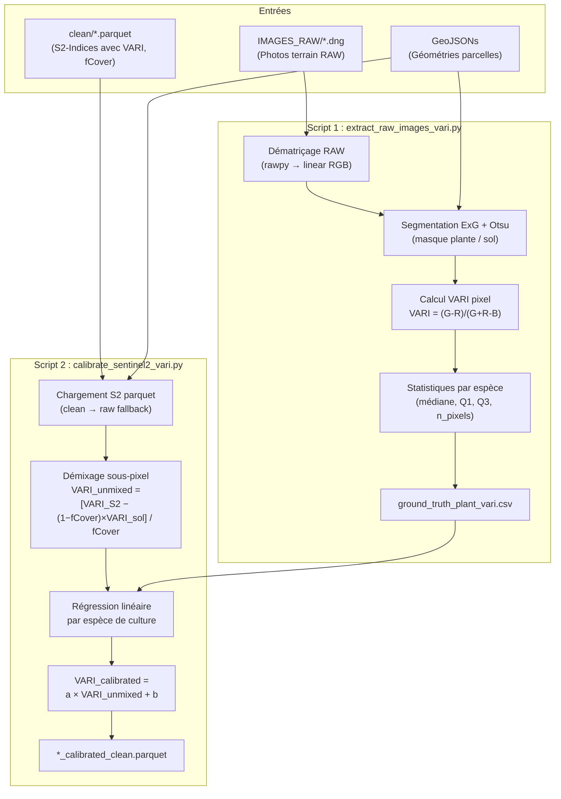

# 📸 Documentation Technique — Module de Calibration VARI Sol-Satellite

**Projet :** AWAM  
**Chemin du module :** `scripts/VARI_CALIBRATION/`  
**Scripts :** `extract_raw_images_vari.py`, `calibrate_sentinel2_vari.py`, `run_vari_pipeline.py`  
**Stage dans le Pipeline Master :** Stage 2  
**Dernière mise à jour :** 26 Août 2026

---

## 📑 Table des matières

1. [Vue d'ensemble & Objectifs](#1-vue-densemble--objectifs)
2. [Architecture & Diagramme de flux](#2-architecture--diagramme-de-flux)
3. [Script 1 — extract_raw_images_vari.py](#3-script-1--extract_raw_images_varipy)
4. [Script 2 — calibrate_sentinel2_vari.py](#4-script-2--calibrate_sentinel2_varipy)
5. [Script 3 — run_vari_pipeline.py (Orchestrateur)](#5-script-3--run_vari_pipelinepy)
6. [Données d'Entrée](#6-données-dentrée)
7. [Sorties Produites](#7-sorties-produites)
8. [Guide d'Utilisation & CLI](#8-guide-dutilisation--cli)

---

## 1. Vue d'ensemble & Objectifs

Le module **VARI_CALIBRATION** assure la **calibration terrain-satellite** de l'indice VARI (Visible Atmospherically Resistant Index) en exploitant des photos terrain haute résolution (`.dng` RAW) prises directement sur les parcelles de Sidi Mechreg.

### Problème résolu

Le VARI calculé par Sentinel-2 à 10m de résolution est un signal **mixte** : chaque pixel contient un mélange de végétation et de sol nu. Sans calibration, ce VARI brut sous-estime systématiquement la vigueur réelle de la plante.

### Approche

1. **Extraire le VARI pur de la plante** et le VARI du sol à partir de photos terrain segmentées
2. **Démixer le pixel satellite** en séparant la contribution sol/végétation via `fCover` SL2P
3. **Calibrer par régression linéaire** le VARI démixé vers le VARI terrain, par espèce végétale

---

## 2. Architecture & Diagramme de flux



---

## 3. Script 1 — `extract_raw_images_vari.py`

### Rôle
Traite les photos terrain RAW (`.dng`) pour en extraire le VARI pur de chaque espèce végétale photographiée.

### Étapes détaillées

1. **Dématriçage RAW** (`rawpy`) : Conversion du fichier `.dng` en espace colorimétrique RGB linéaire non clippé (gamme complète 16 bits)
2. **Segmentation végétale** :
   - Calcul de l'Excess Green : `ExG = 2G − R − B`
   - Seuillage Otsu automatique pour séparer plante / sol nu
   - Export du masque de segmentation visuel
3. **Calcul VARI par pixel** :

$$\text{VARI} = \frac{G - R}{G + R - B}$$

4. **Statistiques de sortie** : Pour chaque photo → médiane VARI plante, médiane VARI sol, nombre de pixels plante, couverture végétale (%)
5. **Export** : `outputs/raw_vari_calibration/ground_truth_plant_vari.csv`

### Résolution parcelle dynamique
Les parcelles sont chargées dynamiquement depuis les GeoJSONs (`parcelles_fermes_makthar_wgs84_wwc.geojson` & `parcelles_fermes_sidi_mechreg_wgs84_wwc.geojson`). Aucun ID de parcelle n'est hardcodé.

---

## 4. Script 2 — `calibrate_sentinel2_vari.py`

### Rôle
Calibre le VARI satellite Sentinel-2 en utilisant la vérité terrain photo pour produire un VARI physiquement corrigé.

### Modèle de démixage sous-pixel

Le pixel S2 (10m × 10m) contient un mélange sol + végétation. On isole la contribution végétale :

$$\text{VARI}_{\text{unmixed}} = \frac{\text{VARI}_{\text{S2}} - (1 - fCover) \times \text{VARI}_{\text{sol}}}{fCover}$$

Où :
- `VARI_S2` : VARI brut du pixel Sentinel-2
- `fCover` : Fraction de couvert végétal (produit SL2P Sentinel-2)
- `VARI_sol` : VARI médian du sol nu extrait des photos terrain

### Calibration par régression linéaire

Pour chaque espèce de culture :

$$\text{VARI}_{\text{calibré}} = a \times \text{VARI}_{\text{unmixed}} + b$$

Les coefficients `a` et `b` sont ajustés par moindres carrés sur les couples (VARI_unmixed satellite, VARI_terrain photo).

### Normalisation des noms de culture

| Alias d'entrée | Espèce normalisée |
|:---|:---|
| `Advantis`, `Adventice`, `Adventices` | Advantis (Weeds) |
| `Vervaine` | Verveine |
| `Geranium`, `Romarin`, `Lavande` | (conservé tel quel) |

### Sources de données (par priorité)

1. `outputs/pixel_indices_database/clean/AWAM_*S2-Indices*_clean.parquet` ← **prioritaire**
2. `outputs/pixel_indices_database/raw/AWAM_*S2-Indices*.parquet` ← fallback
3. `outputs/pixel_indices_database/sentinel2_indices.csv` ← legacy

### Sorties

- `*_calibrated_clean.parquet` : Fichiers originaux + colonnes `VARI_unmixed` et `VARI_calibrated`
- `sentinel2_indices_calibrated.parquet` : Vue consolidée calibrée
- `plots/` : Graphiques de régression diagnostiques (scatter + droite de calibration)

---

## 5. Script 3 — `run_vari_pipeline.py`

### Rôle
Orchestrateur du module VARI_CALIBRATION. Enchaîne les 2 scripts séquentiellement.

### Arguments CLI

| Argument | Description |
|:---|:---|
| *(aucun)* | Exécute extraction terrain + calibration satellite |
| `--skip-ground` | Saute le traitement des photos DNG (recalibration seule) |
| `--run-extractions` | Lance d'abord l'extraction complète GEE+Earthdata (Stage 1) avant la calibration |

### Chaîne d'exécution

```
run_vari_pipeline.py
  ├── [optionnel] EXTRACT/run_all_extractions.py  (--run-extractions)
  ├── extract_raw_images_vari.py                   (sauf --skip-ground)
  └── calibrate_sentinel2_vari.py
```

---

## 6. Données d'Entrée

| Donnée | Emplacement | Format |
|:---|:---|:---|
| Photos terrain RAW | `IMAGES_RAW/*.dng` | RAW Bayer 16-bit |
| Parquets S2 nettoyés | `outputs/pixel_indices_database/clean/*S2-Indices*.parquet` | GeoParquet |
| GeoJSON Makthar | `scripts/parcelles_fermes_makthar_wgs84_wwc.geojson` | GeoJSON |
| GeoJSON Sidi Mechreg | `scripts/parcelles_fermes_sidi_mechreg_wgs84_wwc.geojson` | GeoJSON |

---

## 7. Sorties Produites

| Fichier | Emplacement | Description |
|:---|:---|:---|
| `ground_truth_plant_vari.csv` | `outputs/raw_vari_calibration/` | VARI terrain par espèce |
| `*_calibrated_clean.parquet` | `outputs/pixel_indices_database/clean/` | S2 indices + VARI calibré |
| `sentinel2_indices_calibrated.parquet` | `outputs/pixel_indices_database/clean/` | Vue consolidée |
| Graphiques de régression | `outputs/raw_vari_calibration/plots/` | Diagnostics visuels PNG |

---

## 8. Guide d'Utilisation & CLI

```powershell
# Exécution complète (extraction terrain + calibration)
python scripts/VARI_CALIBRATION/run_vari_pipeline.py

# Recalibration seule (sans retraiter les photos)
python scripts/VARI_CALIBRATION/run_vari_pipeline.py --skip-ground

# Avec extraction des données complète en amont
python scripts/VARI_CALIBRATION/run_vari_pipeline.py --run-extractions
```

### Prérequis Python

```
rawpy        # Dématriçage fichiers RAW .dng
opencv-python  # Segmentation ExG + Otsu
scipy        # Régression linéaire
geopandas    # Lecture GeoJSON
matplotlib   # Graphiques diagnostiques
```

### Impact sur les modules en aval

Le VARI calibré (`VARI_calibrated`) est consommé par :
- **SANTE_PLANTES** : Score de vigueur végétative ($S_1$) utilise `VARI_calibre` dans `compute_health_scores.py`
- **MODULE_ALERTES** : Hérité via l'import de `construire_panel()` depuis IRRIGATION
